# Implementation status

## Capability and evidence inventory

| Capability                                                                                                                     | Implementation / validation                                                                                                                                                                             |
| ------------------------------------------------------------------------------------------------------------------------------ | ------------------------------------------------------------------------------------------------------------------------------------------------------------------------------------------------------- |
| API liveness and PostgreSQL readiness                                                                                          | `app/api/health.py`; `tests/test_health.py`, `tests/test_postgres.py`                                                                                                                                   |
| Protected minimal identity endpoint                                                                                            | `app/core/auth.py`, `app/api/identity.py`; `tests/test_identity.py`                                                                                                                                     |
| Private display-name/icon account settings and dashboard profile                                                               | `app/api/account.py`, `app/db/account.py`, `app/schemas/account.py`, `frontend/app/(app)/account/`; `tests/test_account.py`, `frontend/tests/account.test.js`, `frontend/tests/browser/account.spec.js` |
| Bottom sidebar account menu with avatar, name, optional session email, account links, and sign-out                             | `frontend/components/account-menu.jsx`, private layout, registry avatar/dropdown primitives; account and wallet browser tests                                                                           |
| Account-menu Settings with per-user light/dark theme and keyboard-operable desktop/mobile sidebar ordering | `app/api/preferences.py`, `app/db/preferences.py`, `012_user_preferences.sql`, `/settings`, root SSR theme; account database tests, `frontend/tests/settings.test.js`, settings/interface/token-refresh browser tests |
| Unified icon-or-upload profile picture with bounded image decoding, resizing, and metadata removal                             | `app/services/profile_images.py`, `005_account_avatar.sql`, `frontend/components/account-picture-form.jsx`; API refusal/normalization tests and browser picture-selection/retry workflow                |
| Private wallet CRUD, bank/trading/exchange types, stored custom favicons, EUR-default currency, protected references, and exact due-occurrence current balances | `app/api/wallets.py`, `app/services/wallets.py`, `app/services/wallet_icons.py`, `app/db/wallets.py`, shared occurrence SQL, migrations 009/011; wallet/icon/transaction database tests |
| Forward-only transactional schema migrations                                                                                   | `app/db/migrate.py`, numbered files in `app/db/migrations/`; PostgreSQL migration/default/constraint tests                                                                                              |
| Public welcome page and authenticated landing dashboard                                                                        | `frontend/app/`, Auth0 SDK and server-only adapter                                                                                                                                                      |
| Shared responsive sidebar, active navigation, and sign-out                                                                     | `frontend/app/(app)/layout.js`, `frontend/components/app-sidebar.jsx`; authenticated desktop/mobile browser test                                                                                        |
| Unified welcome, dashboard, wallet, transaction, category, and account design; compact mobile navigation and focused workflows | Shared page heading/feedback, semantic theme tokens, shadcn recipes; `frontend/tests/browser/interface.spec.js` and mutation browser workflows                                                          |
| Global shadcn preset b2CjxkLGi: Radix Mira, Mist/Emerald and self-hosted IBM Plex Sans with inherited headings and tabular amounts | `frontend/components.json`, root font loader, global theme/accessibility rules and regenerated UI primitives; cross-page geometry/typography, responsive, loaded-font, no-browser-provider-request and OKLCH-aware contrast browser checks |
| Paginated SSR wallet table, six-currency picker, exact-entry amount slider, icon radio tiles, and session-checked create/edit/delete dialogs | `frontend/app/(app)/wallets/`, `frontend/components/wallet-form.jsx`, `frontend/components/wallet-list.jsx`; wallet unit/browser tests |
| Owner-scoped database pagination and totals                                                                                    | `app/api/wallets.py`, `app/db/wallets.py`; PostgreSQL page boundaries, stable ordering, and cross-owner count/list tests                                                                                |
| Private editable two-level categories and optional predefined groups                                                           | `app/api/categories.py`, `app/db/categories.py`, `app/services/category_presets.py`, `frontend/app/(app)/categories/`; `tests/test_categories.py`, frontend adapter and browser tests                   |
| Searchable category cards, focused appearance editors, safe deletion dialogs, and an optional preset sheet                     | `frontend/components/category-workspace.jsx`, `category-manager.jsx`, registry primitives, category search unit tests, desktop/mobile browser workflows                                                 |
| Private income/expense/transfer CRUD, exact amounts, owned wallet/category references, and protected category deletion         | `app/api/transactions.py`, `app/db/transactions.py`, `app/schemas/transactions.py`, `004_transactions.sql`; `tests/test_transactions.py`                                                                |
| Signed nonzero expenses, separate immutable income/expense category families, and five optional income presets | Migration `010_category_kinds_signed_expenses.sql`, amount/family schemas, generated family FK, typed CSV lookup/proposals, signed plot normalization and UI; migration/API/unit/browser regressions |
| Weekly/monthly/annual recurring series, finite or indefinite, anchored calendar dates                                          | `app/services/transactions.py`, read-only occurrence projection in `app/db/transactions.py`; database month-end, leap-year, count, and future-start tests                                               |
| Paginated/filterable SSR Transactions page, dependent selectors, series editing and confirmed deletion                         | `frontend/app/(app)/transactions/`, `frontend/components/transaction-*.jsx`; `frontend/tests/transactions.test.js`, `frontend/tests/browser/transactions.spec.js`                                       |
| Compact wallet-icon transaction rows, three-dot actions, page-scoped bulk editing/deletion and persistent whole-series pins | Migration `013_transaction_pins.sql`, transaction schemas/services/persistence, shared partial form and owner-scoped atomic bulk routes; database refusal/rollback/pagination tests, frontend unit tests and `transaction-bulk.spec.js` |
| Month-based transaction workspace, search/filter overlays, illustrated empty state, and toolbar creation dialog                | `frontend/components/transaction-workspace.jsx`, `transaction-empty.jsx`, registry primitives, URL-period unit tests, desktop/mobile browser workflows                                                  |
| Transaction type switches, category donuts with exact center totals, signed net bars and collapsed wallet expenses | Transaction listing schemas/query, `transaction_summary.py`, `transaction-summary.jsx`, `money-amount.jsx`; database aggregation/recurrence, adapter refusal and responsive browser tests |
| Private annual expense/income analysis, monthly/yearly category/subcategory tables, grouped monthly bars and diverging net bars | `app/api/summary.py`, `app/services/summary.py`, `app/db/summary.py`, `app/schemas/summary.py`, `/summary`, `expense-summary.jsx`, `expense-charts.jsx`; database, adapter and browser tests |
| Shadcn category-ranking/monthly-trend charts and 2–6-period month/year/yearly-range-average comparisons | `app/db/expense_comparisons.py`, Summary schemas/services/routes, `expense-charts.jsx`, `expense-comparison.jsx`, registry Chart/Recharts; exact geometry/rounding, private transport, and browser comparison tests |
| Dedicated Compare spending page and reorderable sixth sidebar entry | `/compare-spending`, independently authenticated page/action, migration `014_comparison_navigation.sql`; saved-order migration, settings, private-route and responsive comparison browser tests |
| Annual per-currency patrimony, live/frozen wallet cash, manual asset/liability valuations, Summary-consistent charts and seventh navigation feature | `app/api/assets.py`, `app/db/assets.py`, `app/services/assets.py`, `015_assets.sql`, `/assets`, `asset-*.jsx`; `tests/test_assets.py`, frontend adapter and authenticated browser tests |
| Neutral signed Balance Adjustment and immutable automated UTC month-end closure with live current-month refresh | Migrations 016–017, shared movement projection, `app/db/asset_snapshots.py`, lifespan worker, transaction/CSV UI; PostgreSQL boundary/concurrency/deletion/currency/lifecycle tests and authenticated browser workflows |
| Server-side SDK token renewal, rotated-cookie persistence, safe reauthentication and retryable provider failures | `frontend/lib/auth0.js`, `auth-errors.js`, `api.js`, `proxy.js`; typed-error unit tests and synthetic-provider `token-refresh.spec.js` |
| Reviewed CSV transaction import with mapping, approved missing-record creation, exact amount/date normalization, row corrections/exclusion, and atomic safe-retry confirmation | `app/services/transaction_imports.py`, `app/services/import_formats.py`, `app/db/transaction_imports.py`, `006_transaction_imports.sql`, import dialog/actions; API/database, adapter, and CSV browser tests |
| API token origin/cache/response boundaries                                                                                     | `frontend/tests/config.test.js`, `frontend/tests/api-client.test.js`                                                                                                                                    |
| Unconfigured browser setup and private-route refusal                                                                           | `frontend/tests/browser/bootstrap.spec.js`                                                                                                                                                              |
| Persistent live-reloading Docker development and isolated production/test topology                                             | `compose.yaml`, `compose.dev.yaml`, `docker/`, `Makefile`; Uvicorn reload and Next.js Fast Refresh                                                                                                      |

Wallets support private editing, protected deletion, EUR-default currencies,
and exact current balances through today UTC. See [wallet balances and management](#wallet-balances-and-management).
Manual asset/liability tracking is implemented; live quotes and quantities remain planned.
Currency conversion, cross-currency aggregates, transaction export,
individual recurring-occurrence exceptions,
and local password accounts are not implemented. The Auth0 flow requires a configured external tenant;
automated bootstrap checks do not prove a live end-to-end provider login.

## Verification scope

Balance updates passed backend tests against isolated PostgreSQL, all 68 frontend
unit tests, backend/frontend lint and formatting, a production SSR build, and eight
focused Chromium workflows. Coverage includes exact cash/recurrence/
transfer/refund handling, owner isolation, nonprovisioning reads, valuation upserts,
zero/missing/future values, undefined percentages, composite ownership constraints,
order-preserving navigation migration, retained failed-save edits, preserved frozen
history after deletion, shared year navigation, aligned chart headers/plots, colored exact tooltips,
bar/line/donut switching, authentication and explicit read failures.
Responsive/dark navigation checks include Assets at 320–1440 pixels; populated
desktop and mobile/dark screenshots were inspected. Browser tests use synthetic
sessions and a mock API; PostgreSQL tests establish real persistence and ownership.
Snapshot checks cover concurrent/idempotent UTC closure, December/January rollover,
pre-mutation downtime catch-up, currency changes, late-source coverage, immutable
updates, next-month signed adjustments, P&L exclusion, worker outage retry and
shutdown cleanup. Browser checks cover closed-source controls, preserved failed-save
form edits and visible-page refresh after an external transaction.

The compact transaction list, bulk actions and persistent pins passed 257
database-backed transaction/wallet tests, all 64 frontend unit tests, all 24
Chromium workflows with one worker, Python/frontend lint and formatting, and
the standalone production build. Coverage includes closed/bounded selections,
foreign/missing-ID atomic refusal, mid-batch rollback, exact partial changes,
mixed-type refusal, persistent pin-first pagination, synchronized series
selection, retained fields/edits after failed saves, page resets, focus recovery,
and confirmed whole-series deletion. Desktop/light/dark and mobile menu
screenshots were inspected. Browser tests use synthetic Auth0 sessions and a
mock API; PostgreSQL tests cover real ownership and persistence.
Migration `013_transaction_pins.sql` is applied in development; its boolean
column is nonnullable and defaults false. Live readiness/frontend checks and
registered bulk/pin contracts passed; development services remain running.

Global preset `b2CjxkLGi` passed all 61 frontend unit tests, all 23 Chromium workflows,
frontend lint/formatting and the standalone production build. Browser coverage
checks loaded IBM Plex Sans for body/headings and tabular numeric values,
matching cross-page navigation controls, panel corners and dialog titles,
44-pixel slotted close controls after animation, no font-provider browser requests,
320–1440-pixel navigation, reduced motion, saved light/dark settings, focused
dialogs and keyboard controls, transaction badges, and chart text contrast
converted from OKLCH to sRGB. The new consistency regression first reproduced
the month-arrow shape override, then passed after removing it. Light desktop, dark desktop and mobile
screenshots were inspected. Financial semantic colours and exact decimal
behavior remain unchanged. No dependency, API or schema change was needed.

Category-card and month-rail padding corrections passed seven targeted category,
transaction and cross-page browser workflows, frontend lint/formatting and the
production build. Geometry regressions first reproduced missing card gutters
and asymmetric month-button inset, then verified shared card spacing in both
themes on desktop/mobile and balanced month inset at 375–1920 pixels. Populated
category cards and month-rail screenshots were inspected; centering, horizontal
scrolling and keyboard/mutation behavior remain intact.
Live frontend/readiness return 200 and development services remain running.

Workspace settings passed all 65 account/settings API tests against isolated
PostgreSQL, all 61 frontend unit tests, backend/frontend lint and formatting,
the production SSR build and nine focused Chromium workflows. Coverage verifies
authentication, closed inputs, complete unique sidebar permutations, database
checks, read-only defaults, owner isolation, profile/image/wallet preservation,
failed-save edit retention, successful light/dark changes, persisted initial
HTML theme, keyboard ordering, desktop/mobile navigation, portaled dialog theme,
explicit read failures and unchanged token renewal/refusal behavior.
Browser sessions/API are synthetic; database tests exercise real PostgreSQL.
The new settings page also passes the existing responsive and dark-contrast
workflow.
The final settings rerun also verifies that keyboard focus moves to an enabled
control at an ordering boundary; light/dark mobile screenshots were inspected.
Migration 012 is applied to the live development database and its ledger/columns
were checked. Readiness and the welcome page return 200; unauthenticated Settings
retains its 307 login redirect. Live-reloading development services remain running.

Summary view controls and chart data footers passed all 185 transaction backend
tests against isolated PostgreSQL, all 57 frontend unit tests, Python/frontend
lint and formatting, a production SSR build, and three focused Chromium workflows.
Coverage includes mutually exclusive monthly views, January-December chart data
even in a partial current year, a nonzero historical December, exact chart totals,
top-ten-only Sum/Average and single-rounding precision, bar/donut switching,
hover values and keyboard-accessible exact tables, and refusal of signed donuts.
Mobile, landscape, reduced-motion and light/dark checks passed; desktop/mobile/dark
screenshots were inspected. Browser sessions/API are synthetic. No dependencies
or migrations changed; the live development stack remains running.

Annual income tables and monthly cash-flow charts passed all 181 transaction
backend tests, all 56 frontend unit tests, Python/frontend lint and formatting,
the production SSR build, and all 19 Chromium workflows with one worker. A final
focused PostgreSQL rerun verified both surplus/deficit geometry after editing
income. Coverage includes exact large-decimal net subtraction, income recurrence,
ownership, future/transfer exclusion, income-only currencies, empty nonprovisioning
reads, income table ordering and monthly/year totals, grouped bars, keyboard
tooltips, and positive/negative bars on opposite sides of zero. Desktop/mobile
screenshots were inspected; dark/landscape coverage passed. Browser sessions/API
are synthetic; database tests exercise real PostgreSQL. No migration or dependency
change was needed; live development services stay running.

The separate expense/income category sections and transaction selector guidance
passed all 55 frontend unit tests, ESLint/Prettier checks, a production SSR build,
and all 19 Chromium workflows with one worker. Browser coverage verifies both
sections together, family-default creation, shared search, family-specific preset
approval, and income transaction creation after returning through browser history.
Type changes clear stale category/child selections and never expose the opposite
family. Desktop, mobile, landscape and dark screenshots were captured; mobile/dark
views were inspected. Category mutations invalidate transaction selectors only
after success. These are frontend-only changes with synthetic browser sessions/API;
no database migration or dependency change was needed.

Signed expenses and category families passed 248 backend transaction/category/wallet
tests, all 55 frontend unit tests, Python/frontend lint and formatting, the standalone
production image build, and all 19 Chromium workflows with one worker. Coverage
includes signed recurrence, balances and summaries, exact negative averages/geometry,
absent-zero comparison ranking, family isolation in API and database constraints,
and family-specific CSV resolution. A focused 64-test CSV rerun also verified
compatibility of existing approval identifiers. Isolated-schema migration tests
passed; migration 010 was applied to the live development database and its ledger
entry checked. Signed-chart mobile/dark screenshots were inspected. Browser sessions
and financial APIs are synthetic; PostgreSQL-backed tests cover actual persistence,
ownership and aggregation. No dependencies changed; live-reloading services remain
running. Historical income moves to income Other without changing amounts, as
documented in [the migration contract](API.md#category-family-migration).

Yearly range averages and token renewal passed 33 focused PostgreSQL-backed
backend tests, all 51 frontend unit tests, Python/frontend lint and formatting,
the standalone production image build, and all 17 Chromium workflows with one
worker. Coverage includes inclusive/overlapping ranges, zero-spend years,
partial-current-year denominators, invalid/future endpoints and exact
single-rounding precision. SDK integration tests verify expired/near-expiry
renewal before SSR, one refresh across the initial render, persisted rotated
refresh tokens usable on the next expiry, HttpOnly cookies, the disabled browser
token endpoint, login-required failures, and explicit retryable provider outages.
Mobile/dark screenshots were inspected. The provider is synthetic: no real
tenant settings or credentials were inspected/changed. Auth0 configuration and
the required fresh sign-in are documented in the frontend guide.
No migration or dependency change was needed; live development services remain
running with the updated comparison contract.

Expense charts and period comparisons passed 28 focused backend tests (including
real PostgreSQL ownership, recurrence, empty-read, large-number and single-rounding
cases), all 49 frontend unit tests, Python/frontend lint and formatting, the
standalone production build, and all 12 Chromium workflows with one worker.
Browser coverage includes month/year/average comparisons, three and six selected
periods, duplicate refusal, preserved edits/results after failure, exact-value
keyboard tooltips, and keyboard scrolling in chart/comparison data tables.
Chart label contrast was measured at a minimum 4.5:1 in both themes; mobile,
landscape, dark mode and reduced-motion checks passed. Screenshots were inspected.
The production-dependency audit reported no vulnerabilities; existing tooling-only
advisories remain separate. Live readiness, both new registered routes, and the
private Summary redirect were verified. The Recharts dependency was refreshed
with `make local-dev-up`; no migration was needed.

Annual expense analysis passed 182 distinct transaction/wallet backend tests
across the suite and focused precision rerun, all 45 frontend unit tests,
Python/frontend lint and formatting, the production SSR image build, and all
12 Chromium workflows. The full browser suite ran with one worker because
existing wallet/category workflows share a mock owner.
Coverage includes owner isolation, nonprovisioning empty reads, exact
monthly/category/subcategory/currency totals, anchored and finite recurrence,
future-entry exclusion, yearly navigation/history/bounds, hideable subtotals,
expanded/collapsed details, authentication and explicit backend refusal.
Desktop, 375-pixel mobile, landscape, and dark summary screenshots were inspected;
reduced-motion scrolling and 320–1440-pixel navigation checks passed.
Browser sessions/API are synthetic; PostgreSQL tests validate actual persistence
and aggregation. Live readiness, the registered twelve-month summary contract,
and the private Summary login redirect were verified. Validation services were
removed without stopping the live reload-enabled development stack.
No migration or dependency change was required.

The transaction overview update passed 168 database-backed transaction/wallet
tests, all 42 frontend unit tests, five Chromium transaction/import/responsive
workflows, Python/frontend lint and formatting, and the production SSR build.
Coverage includes exact cross-page/filter/owner/currency totals, anchored
recurrence and future initial entries, transfer exclusion from net, currency
symbols without rounding, separate year/month navigation and history, retained
All dates month groups, and default-closed wallet expenses.
Desktop, 375-pixel mobile, landscape, and dark summary screenshots were inspected;
mobile disclosure also ran with reduced motion.
Browser checks use synthetic Auth0 sessions and a mock API; database tests cover
real PostgreSQL aggregation and ownership. Live readiness, frontend HTTP 200,
and required OpenAPI summary/currency fields were verified. Validation containers
were removed; reload-enabled development services stayed healthy and running.
No migration, dependency change, or development service restart was needed.

Native backend/frontend unit tests, Python and frontend lint/format checks, the
production standalone SSR build, and the Chromium smoke test passed during
initialization. All Compose profiles passed configuration validation using the
standalone Compose CLI.

Docker became available during wallet implementation. Wallet/backend tests
passed in isolated containers against PostgreSQL, including migration
repeatability, the database zero default, decimal precision, and cross-user
isolation. The full Docker `make check` passed, including frontend lint,
formatting, production image build, and the mock-backed authenticated wallet
browser test. Production containers also started successfully with the
migration-before-API dependency, and database metadata matched the ER diagram's
tables, types, nullability, ownership foreign key, and zero default.

The sidebar/pagination update passed Docker-based wallet tests, frontend unit
tests, Python/frontend lint and formatting, a production SSR build, and all
three browser tests. These cover unauthenticated refusal, active sidebar links,
mobile navigation, pagination/reloads, invalid and nonexistent pages, and
creation while viewing a later page.

The account-management update passed 46 account/wallet backend tests against
PostgreSQL, 17 frontend unit tests, Python/frontend lint and formatting, a
production SSR build, and all four browser tests. Profile tests verify
owner isolation, defaults without provisioning, wallet preservation, persisted
edits, dashboard updates, and retaining edits after validation/save failures.

The categories update passed 73 category/account/wallet backend tests against
PostgreSQL, 20 frontend unit tests, Python/frontend lint and formatting, a
production SSR build, and all five browser tests. Tests verify the exact
requested catalogue, optional selected imports, private customization,
idempotence, CRUD isolation, cancellation/confirmation, and database rejection
of foreign-owner and third-level parents.

All fifteen Mermaid diagrams rendered successfully in local Chromium. The
local stack was rebuilt and `003_categories.sql` applied without replacing the
existing PostgreSQL volume. Live schema metadata matched the two-level model,
including its composite owner/parent foreign key, cascades, and unique preset
keys. The live catalogue contains ten groups and 40 subcategories; private
page/API requests still reject unauthenticated access.

Browser wallet tests use the Auth0 SDK's synthetic-session utility and a mock
API; real persistence is tested separately against PostgreSQL. A real external-provider login still requires
tenant configuration.

The production npm audit is clean. The full audit reports upstream
development-tool advisories in the ESLint/shadcn dependency trees; compatible
automatic fixes were unavailable. No forced downgrades or breaking dependency
overrides were applied.

The live-development workflow passed both Compose configuration checks and the
full isolated Docker `make check`: 90 backend tests, 20 frontend unit tests,
Python/frontend lint and formatting, a production SSR build, and five browser
tests. A live Chromium probe verified Fast Refresh updated an open page after a
host JSX edit, and a Python edit changed the API response without recreating
either application container or PostgreSQL. Temporary probes were removed;
the existing database volume was preserved. See the
[live-development sequence](#live-development).

The transactions update passed the complete Docker backend suite (143 tests),
24 frontend unit tests, Python/frontend lint and formatting, a production SSR
image build, and all six Chromium browser tests. PostgreSQL tests cover private
CRUD and references, exact amounts, filtered pagination, protected category
deletion, finite/indefinite recurrence, future starts, month ends, leap years,
repeatable reads without duplicate writes, and direct database constraints.
The mock-backed transaction browser workflow verifies all-wallet choices,
dependent fields, exact strings, failed-save retention, series-wide edits,
filters preserved across pagination/reloads, deletion confirmation/cancellation,
last-page recovery, and mobile overflow. It does not replace a real Auth0 login
or live PostgreSQL browser test.

`004_transactions.sql` was applied to the already-running development database.
Live column/constraint metadata matches the model below; all four migrations
are recorded. The existing API, frontend, and PostgreSQL containers remained
running and healthy. The live OpenAPI includes transaction routes, readiness
returns 200, and unauthenticated transaction page/API access still returns
the expected login redirect/401. The isolated validation database was removed;
the development database and services were left running.

The sidebar/profile-image update passed 158 database-backed Python tests, 25
frontend unit tests, Python/frontend lint and formatting, a production SSR image
build, both Compose configuration checks, and all six Chromium browser workflows.
The account workflow verifies footer placement, keyboard/mobile menus, immediate
name/icon/image synchronization, file refusals, failed-upload retry, image
persistence, and removal. API tests cover bounded image decoding, normalization,
metadata removal, ownership, database constraints, and preservation of existing
profile and wallet data. Browser checks use synthetic sessions and a mock API,
not a real Auth0 login.

Migration `005_account_avatar.sql`, its nullable image column, and storage
constraints were verified in the live database; all five migrations are recorded.
The dependency refresh preserved the existing database volume. Development
services remain healthy and running. Live checks confirmed registered image
routes, unauthenticated 401 refusal, and the private account page's login redirect.

The unified profile-picture selector passed 45 account API/database tests,
seven frontend unit tests, the account Chromium workflow, Python/frontend
lint/formatting, and a production frontend build. Coverage includes icon-to-image
and image-to-icon changes, replacing an image with the same previously stored
icon, isolated ownership, failed-save retries, and name updates that preserve
the active picture. Live source reload exposed the new name/icon mutations with
unauthenticated 401 refusals and a private-page login redirect; no migration or
development-container restart was required.

The month-based transaction workspace passed six focused frontend unit tests,
two Chromium workflows, frontend lint/formatting, and a production build.
Coverage includes UTC/leap-year/year-boundary periods, All dates/custom ranges,
filter-preserving month changes and pagination, dialog creation and failed-save
retention, exact amounts, transfers, recurring-series edits/deletion, keyboard
focus, mobile viewport visibility, and horizontal overflow. Desktop/mobile
screenshots were inspected. Live source reload retained the private-page login
redirect and healthy services; no API/schema change or service restart was needed.

The Categories workspace update passed four focused frontend unit tests, all
eight Chromium workflows, frontend lint/formatting, and a production build.
Coverage includes parent/child name search, accent normalization, complete tree
context, icon keyboard selection, retained icon/preset selections after failed
submissions, deletion refusal/cancellation, focus restoration after removing the
last category, reduced-motion editors, and layouts from 320 to 1440 pixels.
Desktop/mobile workspace, preset-sheet, and editor screenshots were inspected.
Browser checks use synthetic sessions and the mock API, not a real provider login
or PostgreSQL browser session. API contracts, schema, and runtime dependencies
are unchanged. Live services stayed healthy; the updated source is mounted and
private page/API access still refuses unauthenticated requests.

The application-wide redesign passed all 30 frontend unit tests, all nine
Chromium workflows, frontend lint/formatting, and the production SSR image build.
All six pages were checked at 320, 375, 768, and 1440 pixels, with inspected
light/dark screenshots, keyboard focus, reduced-motion behavior, text/control
contrast, short-screen dialogs, and landscape account access. Wallet creation
and transaction editing/deletion retain failed submissions and restore focus.
Populated transaction checks verify that resizing keeps the selected month
visible and that the toolbar creation control cannot cover deletion targets.
The existing Next.js/JSX/Tailwind/shadcn stack, API contracts, database schema,
authentication boundaries, and exact decimal strings are unchanged.

These browser checks use synthetic SDK sessions and an owner-scoped mock API,
not a real Auth0 login or PostgreSQL browser session. The unexpected-error
fallback was compiled/linted but not deliberately triggered in browser tests.
Live readiness and the welcome page return 200; private transaction page/API
requests retain their 307/401 refusals. Development services remain healthy
and running, with updated source available on browser refresh.

The enhanced reviewed CSV import passed 228 database-backed/backend tests, 35 frontend
unit tests, all eleven Chromium workflows plus a final focused CSV rerun, Python/frontend lint and formatting,
and the production SSR image build. Coverage includes UTF-8/BOM and quoted
CSV parsing, malformed/oversized input, manual mapping, missing-field alerts,
defaults/row overrides, excluded records, ownership and ambiguous references,
rollback after a mid-batch failure, confirmation-time reference changes, and
concurrent/repeated retry keys, concurrent different-key reference creation,
read-only missing-record proposals/approval, parent-scoped deduplication,
currency-symbol/grouping refusals, exact localized decimals, and date-format
detection/ambiguity without using invalid-calendar evidence.
Browser coverage verifies discard without
creation, keyboard error links, retained selections, corrections, 422 recovery,
and interrupted-confirmation retry without duplicates, approval before review,
unused-reference removal after exclusion, normalized values alongside CSV cells,
and no writes even after recap approval. Desktop/mobile approval and normalized
review screenshots were inspected; the original workflow retains its
320×480 dialog check.

Browser workflows use synthetic Auth0 sessions and an owner-scoped mock API;
real atomic persistence/ownership is covered separately by PostgreSQL tests.
Migration `006_transaction_imports.sql` was applied to the existing live
database and its five columns verified against the model. All six migrations
are recorded; this enhancement reuses existing tables and requires no new migration.
The database volume and running development services are
preserved. Readiness remains 200, upload rejects unauthenticated access with
401, and the private transaction page retains its login redirect. No runtime
dependency or frontend-stack changes were needed.

Transaction descriptions are now optional for creation, full replacement, and CSV
imports. Omitted/blank values are stored and returned as empty strings; explicit
null and descriptions longer than 500 characters remain invalid. The UI uses a
display-only "Untitled transaction" label without saving it. Migration
`007_optional_transaction_description.sql` removes the nonblank check and adds
the empty-string default without rewriting existing entries. Verification passed
234 backend tests against ephemeral PostgreSQL, 36 frontend unit tests, four
transaction/CSV Chromium workflows using the mock API, lint/formatting, and the
production build. The migration was applied to the live database without
restarting the development services.

Transaction history now uses registry-generated shadcn tables grouped by
occurrence month, preserving the month rail and selected-month filters.
All dates retains separate month sections; pagination is still global.
The API's descending occurrence-date order is preserved before and after page
changes. Semantic headers, keyboard horizontal scrolling, sticky 44-pixel row
actions, wrapped exact amounts/reference names, and readable light/dark rows
were verified in the transaction browser workflows and inspected screenshots.
Validation passed eight PostgreSQL-backed ordering/recurrence cases, 36 frontend
unit tests, focused transaction workflows, lint/formatting, and the production
build. Existing non-transaction browser workflows were also exercised.
The component and transaction-listing sequence diagrams reflect this UI change;
the database schema, API contract, dependencies, and running development stack
remain unchanged.

Category names became case-insensitively unique per owner (now also family-scoped
by migration 010), and subcategory
names per owned parent. Duplicate creation/replacement returns a distinct 409
unique-name error while preserving edits; preset imports skip owned names
without overwriting private records. Migration 008 retains all IDs and
transaction links while suffixing only later legacy duplicates, with collision
and 100-character handling. Type badges use green income, red expense, and blue
transfer semantic tokens in both themes; labels and icons remain available
without relying on color. Validation passed 149 category/transaction backend
tests, 37 frontend unit tests, category/transaction/CSV browser workflows,
lint/formatting, and production builds. Browser checks verified normal-text
contrast for all three badge types in both themes. Migration 008 was applied to
the running development stack without restarting applications.

CSV import now checks predefined main-category names/keys after owned-name/UUID
matches, reuses renamed owned preset copies, and labels new matches in the
approval recap with their canonical appearance and preset provenance.
Only selected rows' referenced children are created at final confirmation;
catalogue checks and approval remain read-only. Existing names/styling and retry
protection are preserved. Validation passed 152 category/transaction backend
tests, 38 frontend unit tests, both CSV browser workflows, lint/formatting, and
production builds. No migration or dependency change was needed.

The wallet-management update passed 243 wallet/transaction/category/account backend
tests, 40 frontend unit tests, wallet/interface/transaction/CSV browser workflows,
Python/frontend lint and formatting, and production SSR builds. Checks cover
exact high-precision balances, future exclusions, anchored finite/indefinite
recurrence, both transfer directions, wallet ownership, protected references,
currency refusals, failed-edit retention, mobile scrolling, and last-page deletion
recovery. Migration 009 was applied to the running development stack; readiness
and frontend responses remained successful without restarting services.

The wallet type/favicon/form update passed 307 wallet/icon/account/transaction
backend tests, 58 frontend unit tests, three wallet/interface browser tests,
Python/frontend lint and formatting, and the production frontend build.
Checks cover public-address pinning, private/redirect/content/size refusals,
ICO normalization, owned image persistence/preservation/removal, keyboard slider
entry without loss of manually entered precision, radio-tile retry state,
type persistence, and phone/landscape layouts. A real public HTTPS favicon
download also produced a normalized PNG. Migration 011 was applied to the
running development database; readiness and frontend HTTP checks remained healthy.
Browser checks use synthetic sessions and a mock API, not real Auth0 login.

Automatic favicon previews passed 87 focused wallet/downloader backend tests,
59 frontend unit tests, three wallet browser tests, lint/formatting, and the
production frontend build. Browser coverage verifies previewing before save,
loading/refusal feedback, stale URL responses, clearing a replacement back to
the saved image, icon switching, cancellation without persistence, and absence
of browser requests to the image host. No migration or dependency change is
required; the development services remain running.

## Application data model

The schema below matches
[`001_wallets.sql`](../app/db/migrations/001_wallets.sql),
[`002_account_profile.sql`](../app/db/migrations/002_account_profile.sql),
[`003_categories.sql`](../app/db/migrations/003_categories.sql),
[`004_transactions.sql`](../app/db/migrations/004_transactions.sql),
[`005_account_avatar.sql`](../app/db/migrations/005_account_avatar.sql),
[`006_transaction_imports.sql`](../app/db/migrations/006_transaction_imports.sql),
[`007_optional_transaction_description.sql`](../app/db/migrations/007_optional_transaction_description.sql),
[`008_unique_category_names.sql`](../app/db/migrations/008_unique_category_names.sql),
[`009_wallet_currency.sql`](../app/db/migrations/009_wallet_currency.sql),
[`010_category_kinds_signed_expenses.sql`](../app/db/migrations/010_category_kinds_signed_expenses.sql),
[`011_wallet_type_icons.sql`](../app/db/migrations/011_wallet_type_icons.sql),
[`012_user_preferences.sql`](../app/db/migrations/012_user_preferences.sql),
[`013_transaction_pins.sql`](../app/db/migrations/013_transaction_pins.sql), and the
migration runner's version ledger. Nullable columns are
`users.display_name`, `users.avatar_png`, `wallets.favicon_png`, `categories.preset_key`, and transactions'
`destination_wallet_id`, `subcategory_id`, `recurrence`, and `recurrence_count`.
Users are provisioned on their
first profile/image save, wallet/category creation, or selected preset import, not
on sign-in or reads.

```mermaid
erDiagram
    users ||--o{ wallets : owns
    users ||--o{ categories : owns
    categories ||--o{ subcategories : contains
    users ||--o{ transactions : owns
    users ||--o{ transaction_imports : confirmed_import_receipts
    users ||--o{ assets : owns
    users ||--o| asset_snapshot_state : month_closure_cursor
    users ||--o{ asset_balance_snapshots : frozen_owned_balances
    assets ||--o{ asset_valuations : dated_owned_values
    wallets ||--o{ transactions : source_or_income_receiver
    wallets |o--o{ transactions : transfer_destination
    categories |o--o{ transactions : categorizes_except_adjustments
    subcategories |o--o{ transactions : optionally_categorizes
    users {
        text subject PK "Verified Auth0 subject"
        varchar(100) display_name "Nullable until saved, nonblank when set"
        varchar(32) icon "Profile icon, default user-round"
        bytea avatar_png "Nullable normalized PNG, 1 through 327680 bytes"
        varchar(5) theme "light default or dark"
        text[] sidebar_order "All seven feature IDs exactly once, default application order"
    }
    wallets {
        uuid id PK "Generated UUID, also composite unique with owner"
        text owner_subject FK "References users.subject"
        varchar(100) name "Nonblank"
        varchar(7) colour "Hex colour #RRGGBB"
        varchar(32) icon "Supported Lucide identifier or custom"
        varchar(8) type "bank default, trading, exchange"
        bytea favicon_png "Nullable normalized PNG, 1 through 327680 bytes; required only for custom"
        numeric initial_amount "Finite decimal, default 0"
        varchar(3) currency "Supported code, default EUR"
        timestamptz created_at "Default now"
    }
    assets {
        uuid id PK "Generated UUID, also composite unique with owner"
        text owner_subject FK "References users.subject"
        text name "Nonblank, 1 through 100 characters"
        text asset_group "cash, stocks, crypto, bonds, other, liabilities"
        text currency "Supported wallet currency allowlist"
    }
    asset_valuations {
        uuid asset_id PK, FK "Composite FK with owner to assets"
        text owner_subject FK "Paired with asset_id"
        date date PK "Dated snapshot, API refuses future dates"
        numeric amount "Finite nonnegative exact total value"
    }
    asset_snapshot_state {
        text owner_subject PK, FK "References users.subject; cascade on user deletion"
        date started_month "First UTC month in seeded history, day 1"
        date through_month "Nullable until closed; latest sealed month, day 1"
        timestamptz created_at "Default now"
    }
    asset_balance_snapshots {
        text owner_subject PK, FK "References users.subject; cascade on user deletion"
        text source PK "wallet or asset"
        uuid source_id PK "Logical source UUID; deliberately no live-source FK"
        text currency PK "Supported wallet currency allowlist"
        date month PK "Sealed UTC month, day 1"
        text name "Frozen nonblank name, 1 through 100 characters"
        text asset_group "cash for wallets; supported holding group"
        numeric amount "Finite signed cash or nullable nonnegative manual value"
        timestamptz captured_at "Default clock_timestamp; UPDATE refused by trigger"
    }
    categories {
        uuid id PK "Generated UUID, also composite unique with owner"
        text owner_subject FK "References users.subject"
        varchar(100) name "Nonblank, lower(btrim(name)) unique per owner and kind"
        varchar(7) kind "expense default or income, immutable through API"
        varchar(7) colour "Hex colour #RRGGBB"
        varchar(32) icon "Supported category icon"
        varchar(32) preset_key "Nullable, unique per owner, preset-copy provenance"
        timestamptz created_at "Default now"
    }
    subcategories {
        uuid id PK "Also composite unique with category and owner"
        text owner_subject FK "Paired with category_id in composite FK"
        uuid category_id FK "References owned categories.id"
        varchar(100) name "Nonblank, lower(btrim(name)) unique per owner and parent"
        varchar(7) colour "Hex colour #RRGGBB"
        varchar(32) icon "Supported category icon"
        timestamptz created_at "Default now"
    }
    transactions {
        uuid id PK "Transaction or recurring-series definition UUID"
        text owner_subject FK "Verified subject, cascade on user deletion"
        varchar(500) description "Optional trimmed string, NOT NULL, default empty"
        numeric amount "Finite nonzero exact decimal, signed for expenses and adjustments"
        date date "Original date, years 0001 through 9999"
        varchar(18) type "income, expense, transfer, or balance_adjustment"
        uuid source_wallet_id FK "Composite with owner, receiving wallet for income"
        uuid destination_wallet_id FK "Nullable, required only for transfer, distinct source"
        uuid category_id FK "Owned main category; null only for adjustment"
        varchar(7) category_kind FK "Generated family; null for adjustment, composite FK"
        uuid subcategory_id FK "Nullable, composite with category and owner"
        varchar(8) recurrence "Nullable, weekly, monthly, or annually"
        integer recurrence_count "Nullable indefinite, otherwise 1 through 10000"
        boolean is_pinned "NOT NULL, default false; applies to the whole definition"
        timestamptz created_at "Default now"
    }
    transaction_imports {
        text owner_subject PK, FK "Verified subject, cascade on user deletion"
        uuid id PK "Per-upload confirmation retry key"
        varchar(64) payload_hash "SHA-256 of canonical request, lowercase hex"
        integer imported "Confirmed definitions, 1 through 500"
        timestamptz created_at "Default now"
    }
    schema_migrations {
        text version PK "Applied SQL filename"
        timestamptz applied_at "Default now"
    }
```

Wallet ownership comes only from the verified subject. The foreign key uses
`ON DELETE CASCADE`; an index on `(owner_subject, created_at, id)` supports
owner-scoped ordered listing. Names are not unique. Colour and icon constraints
match the request schema. Initial amounts default to zero in both API and
database, accept negative values, and are exchanged as exact decimal strings.
`schema_migrations` is infrastructure state, not a user-owned entity.

The display name is optional until the profile is saved, after which updates
require a nonblank name of at most 100 characters. The account icon is one of
`user-round`, `smile`, `cat`, or `rocket`. Profile saves target the verified
subject and do not replace user rows or change wallet ownership. These
preferences do not update Auth0 credentials or its provider profile.
The optional avatar is a validated, static, orientation-corrected PNG at most
256 pixels per side, without source metadata. A nullable `bytea` column stores
only normalized bytes; SQL checks its PNG signature and 320 KiB limit.
Name/icon saves preserve images, and image import/removal preserves all other
profile and financial data. API responses expose a private PNG data URL, not a
public asset URL or original file. Email is read only from the frontend SDK
session for the sidebar, not persisted in this schema.

Categories use two tables rather than a self-referencing hierarchy. The
subcategory composite foreign key `(category_id, owner_subject)` references the
unique `(id, owner_subject)` key on main categories, enforcing ownership and a
maximum depth of two in PostgreSQL. Parent deletion cascades to children.
Indexes support owner-scoped name/UUID ordering. Optional presets are templates
in application code, not shared user rows; `(owner_subject, preset_key)` prevents
duplicate imports while allowing multiple custom categories with null keys.
Unique indexes on `(owner_subject, kind, lower(btrim(name)))` for main categories and
`(owner_subject, category_id, lower(btrim(name)))` for children prevent duplicate
names within their respective scopes. Migration 008 preserves the oldest name,
suffixes later legacy duplicates without collisions, and changes no identifiers
or transaction references. Main roots have an immutable `expense`/`income` kind;
children inherit their owned parent's kind without an additional column.
The income catalogue is Salary, MealTicket, Transfer, Cash, and Other (refund,
private sell); expense and income presets remain optional private copies.

Transactions store one definition for a single income/expense/transfer or a
recurring series. Composite foreign keys pair both wallets and the main category
with the transaction owner, and pair the subcategory with its selected category
and owner. Referenced categories cannot be deleted (409); financial history is
never cascaded away by category deletion. Source/destination/category/subcategory
indexes support reference checks; `(owner_subject, date DESC, id)` supports
owner/date access. Transfers require two distinct wallets; non-transfers forbid
a destination. Amounts are finite nonzero `numeric`, exchanged as strings.
Only expense amounts may be negative: they reduce expense totals and increase
balances, never become income. Income/transfer amounts remain positive. The stored
generated `transactions.category_kind` is income for income, expense otherwise.
Its composite FK to `(categories.id, owner_subject, kind)` prevents cross-family
references even in direct SQL. It is not accepted or exposed by the API.
Migration 010 preserves existing categories as expense and seeds income presets
for owners with historical income, reassigning only their income definitions to
income Other and clearing the former expense subcategory. Money, IDs, dates,
wallets, recurrence, and expense/transfer references are preserved.

Listing projects occurrences through the service's current UTC date in a
read-only snapshot. A future first occurrence is visible, but future repetitions
are not. Weekly repeats advance seven days; monthly/annual dates derive from the
original date and clamp shorter months without drifting. A finite count includes
the first occurrence, while null means indefinitely. Edits/deletes target the
entire definition/series, including history, and are explicitly labeled.
Occurrences have no separate table and need no scheduler. Wallet initial amounts
remain unchanged by transaction writes. Live balances are calculated; completed
monthly closes are stored immutably and carried into the next month;
manual assets use separate dated valuations. Referenced wallets cannot be deleted or
change currency. Transfer currencies are checked under shared wallet locks.
Keep this Mermaid ER diagram synchronized with actual migrations.

`transaction_imports` stores only successful subject-scoped confirmation
receipts. Its composite primary key and transaction advisory lock serialize
retries; a payload hash rejects different-data reuse. No raw CSV/staged rows are
persisted, and no receipt exists for upload, validation, or cancellation.

## Architecture diagrams

### Application navigation

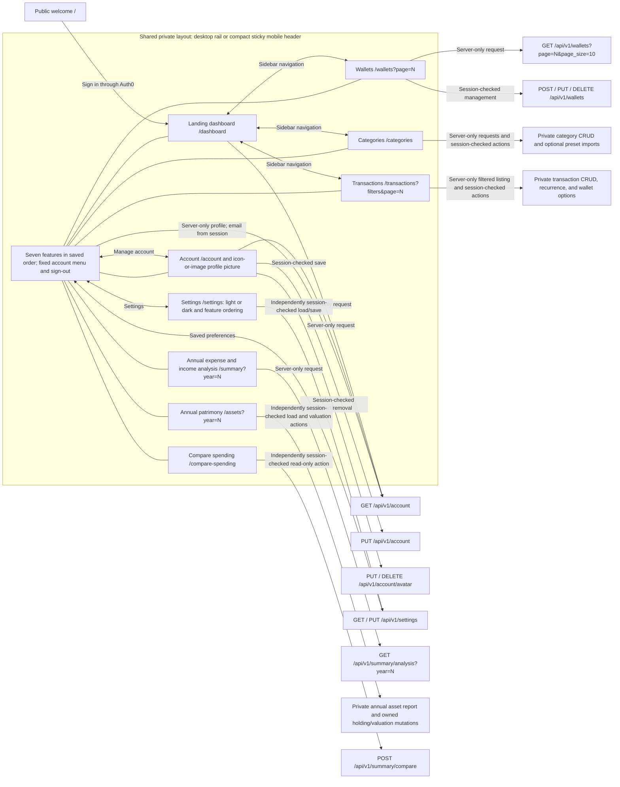

Each private page and server action enforce sessions independently of the
layout. The public welcome page is not part of the private navigation shell.

### High-level components

```mermaid
flowchart LR
    Browser["Browser"] --> Frontend
    subgraph Web["Next.js frontend"]
        Frontend["SSR and server actions"]
        Design["Global preset b2CjxkLGi: Mira Mist/Emerald and IBM Plex Sans"]
        Frontend --> Design
        Design --> Tokens["Root font, light/dark palette, radius and semantic status/ink tokens"]
        Tokens --> Primitives["Shared shadcn primitives, preset card spacing and global 44px accessibility rules"]
        Primitives --> Surfaces["All public/private pages, tabular amounts, menus, sheets and dialogs"]
        FontBuild["Next.js build or development compiler"]
        FontAssets["Self-hosted IBM Plex Sans CSS and font assets"]
        FontBuild -->|"Compile font variables and static assets"| FontAssets
        Frontend -->|"Same-origin font delivery"| FontAssets
        SettingsUI["Account-menu Settings; light/dark radios and labelled move-up/down buttons"]
        Frontend -->|"Validated owned settings; root html theme before response"| SettingsUI
        SettingsUI -->|"Session-checked save; root revalidation only on success"| Frontend
        WalletUI["Wallet table with type and saved icon; six-currency picker, exact-entry amount slider, icon radio tiles and automatic favicon URL previews; protected deletion alerts"]
        Frontend -->|"Owned page, exact amount strings, UTC balance date"| WalletUI
        WalletUI -->|"Session-checked management"| Frontend
        Workspace["Shadcn separate year picker and centered twelve-month rail with narrow-screen horizontal scrolling, visible filters, month-grouped tables, editors and deletion alerts"]
        Frontend -->|"Owned data props, no API tokens"| Workspace
        Workspace -->|"URL filters and form actions"| Frontend
        TransactionTable["Header type switches; selection, wallet icons, description/categories with type badges, short dates, exact signed amounts and sticky three-dot menus"]
        Workspace -->|"Pinned section then month groups; preserve server order"| TransactionTable
        TransactionTable -->|"Session-checked edits, pins and atomic bulk changes/deletion"| Frontend
        SummaryUI["Red-gradient expense and green income donuts; exact center totals below tooltips; labelled net bars; collapsed wallet expenses"]
        Workspace --> SummaryUI
        Frontend -->|"Whole-filter exact totals, no unpaginated rows"| SummaryUI
        ImportUI["Shadcn CSV upload, field/format mapping, missing-record and predefined-match recap, and paginated transaction review"]
        Workspace --> ImportUI
        ImportUI -->|"Session-checked upload, validation and confirmation"| Frontend
        Categories["Shadcn category cards, local tree search, unique-name hints and refusal feedback, editors, deletion alerts, preset sheet"]
        Frontend -->|"Owned tree and available presets, no API tokens"| Categories
        Categories -->|"Session-checked form actions"| Frontend
        AnalysisUI["Annual expense tables followed by income tables, by currency; year navigation and expandable category details"]
        Frontend -->|"Exact monthly/yearly aggregates, no raw financial rows"| AnalysisUI
        AnalysisUI -->|"URL year selection"| Frontend
        ChartsUI["Summary: aligned 240px plots, title-right toggles and colored tooltips; monthly currency axes; bar/donut ranking with exact data"]
        Frontend -->|"Exact amount strings, monetary tick labels and dimensionless geometry"| ChartsUI
        ComparisonUI["Dedicated Compare spending page with period controls, grouped bars and exact tables"]
        Frontend -->|"Independently authenticated page; current UTC defaults"| ComparisonUI
        ComparisonUI -->|"Session-checked read-only period comparison"| Frontend
        AssetUI["Assets: per-currency patrimony cards, aligned chart toggles, grouped monthly snapshots and valuation dialogs"]
        Frontend -->|"Exact values, missing coverage and dimensionless geometry"| AssetUI
        AssetUI -->|"Year URL and independently session-checked valuation actions"| Frontend
    end
    Browser <-->|"Provider sign-in"| Auth0["Auth0"]
    FontBuild -->|"Build-time HTTPS font download only"| FontSource["Google Fonts"]
    Browser -->|"Own-origin static font request; no provider request"| FontAssets
    Frontend --> AuthSession["Auth0 SDK proxy and server-only token adapter"]
    AuthSession <-->|"Server-only authorization-code and refresh-token exchanges"| Auth0
    AuthSession -->|"Rotated encrypted HttpOnly session cookie"| Browser
    Frontend -->|"Server-only bearer request"| API["FastAPI"]
    API -->|"Validate issuer, audience, signature"| Auth0
    API -->|"Bounded image bytes"| ImageService["Pillow profile-image normalization in worker thread"]
    ImageService -->|"Validated metadata-free PNG"| API
    API -->|"Subject-scoped profiles, wallets, categories, and readiness"| DB[("PostgreSQL")]
    API --> SettingsStore["Verified-subject theme and complete sidebar order; defaults only after successful read"]
    SettingsStore -->|"Read without provisioning; upsert only preference columns"| DB
    API -->|"Transaction listing and atomic bulk changes"| Service["Transaction service: fixed UTC recurrence horizon and owned checked-field batches"]
    API -->|"Transaction CRUD, signed amounts and typed references"| Store["Transaction persistence, generated category-family FK, occurrence projection and filtered currency/wallet aggregates"]
    Store -->|"Whole-filter category and currency aggregates"| TransactionCharts["Transaction-summary service: exact signed dimensionless chart geometry"]
    API --> CategoryStore["Owned two-level categories; immutable root kind and optional income/expense presets"]
    CategoryStore --> DB
    Service --> Store
    API -->|"Wallet reads and updates"| WalletService["Wallet service: fixed UTC balance horizon, bank/trading/exchange labels"]
    WalletService --> Favicon["Bounded HTTPS favicon download, checked public address pinning, no redirects or credentials"]
    Favicon -->|"TLS-verified image request on debounced preview or explicit save"| ImageHost["User-selected public image host"]
    Favicon -->|"ICO, PNG, JPEG or WebP"| ImageService
    ImageService -->|"Normalized wallet PNG"| WalletService
    WalletService --> WalletStore["Owned wallet CRUD and due-movement aggregation"]
    WalletStore --> Projection["Shared anchored occurrence SQL"]
    Store --> Projection
    API --> AnalysisService["Annual expense/income service: fixed UTC cutoff and exact rational chart geometry"]
    AnalysisService --> AnalysisStore["One owned expense/income snapshot; grouped category totals and exact monthly net"]
    AnalysisStore --> Projection
    AnalysisStore -->|"One read-only exact numeric query"| DB
    API --> AssetService["Asset service: current UTC checkpoints, carry-forward values, exact net worth and change"]
    AssetService --> AssetStore["Owned wallet cash and dated asset/liability snapshot query"]
    AssetStore --> Projection
    AssetStore -->|"Read-only snapshot; separately transactional owned valuation writes"| DB
    AnalysisService --> CompareStore["Owned multi-period grouping sets; exact sums and once-rounded yearly range averages"]
    CompareStore --> Projection
    CompareStore -->|"One read-only snapshot for every selected period"| DB
    WalletStore -->|"Exact numeric sums, owner-scoped snapshot, protected reference mutations"| DB
    Store -->|"Owned definitions, composite FKs, filtered snapshot pagination"| DB
    API -->|"Bounded CSV and mapped JSON"| CSV["Python CSV parser and row validation"]
    CSV --> Formats["Exact currency-marker/decimal and calendar-date normalization"]
    CSV -->|"Match main-category names/keys and canonical appearance"| Presets["Read-only predefined category catalogue"]
    Formats --> CSV
    CSV -->|"Header matches and row-specific errors"| API
    API -->|"Read-only preview/approval or atomic confirmation"| ImportStore["Owned reference resolution, missing-record proposals, reference locks, and import retry receipts"]
    ImportStore --> CSV
    ImportStore -->|"Approved missing references, selected transactions, and hash/count receipt in one transaction"| DB
```

### Development topology

`make local-dev-up` adds the development override; `make local-containers-up`
uses the base production-mode services instead. Both share the same database
volume and loopback URLs. Test services do not inherit development mounts.

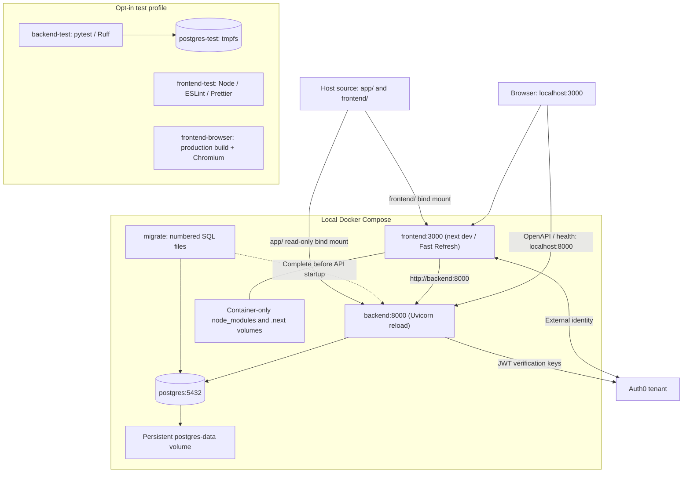

### Deployment boundary target

This is a target trust-boundary view, not provisioned infrastructure.

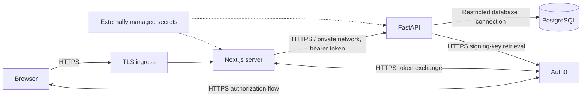

## Operation sequence diagrams

Maintain this operation index as operations are added:
[sign-in/session](#sign-in-and-session),
[token renewal](#token-renewal),
[authenticated profile](#authenticated-profile),
[account update](#account-update),
[workspace settings](#workspace-settings),
[preset typography](#preset-typography),
[profile image import and removal](#profile-image-import-and-removal),
[wallet creation](#wallet-creation),
[wallet listing](#wallet-listing),
[wallet balances and management](#wallet-balances-and-management),
[category management](#category-management),
[predefined category selection](#predefined-category-selection),
[transaction management](#transaction-management),
[transaction bulk changes and pins](#transaction-bulk-changes-and-pins),
[signed expenses and category families](#signed-expenses-and-category-families),
[transaction listing and recurrence](#transaction-listing-and-recurrence),
[annual expense analysis](#annual-expense-analysis),
[expense charts and period comparisons](#expense-charts-and-period-comparisons),
[assets and patrimony](#assets-and-patrimony),
[CSV transaction import](#csv-transaction-import),
[live development](#live-development),
[database migration](#database-migration),
[readiness](#database-readiness),
[unconfigured setup](#unconfigured-setup).

### Assets and patrimony

Balance Adjustment is a separate signed transaction type, without category,
destination or recurrence. It changes only the following month's starting wallet
balance and is excluded from P&L and spending analyses.

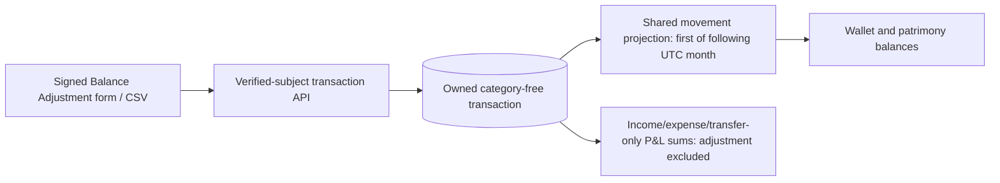

```mermaid
sequenceDiagram
    actor User
    participant Web as Next.js server action
    participant API as FastAPI
    participant DB as PostgreSQL
    User->>Web: Signed adjustment and posting date
    Web->>Web: Require session; clear category and recurrence
    Web->>API: POST type balance_adjustment with server-only token
    API->>DB: Validate owned wallet; insert neutral reconciliation
    DB-->>API: Commit exact signed amount
    API-->>Web: 201, private no-store
    Web->>Web: Revalidate transactions, wallets and Assets after success
    Note over API,DB: Posting month balance unchanged; following month includes delta
    Note over API,DB: P&L aggregates exclude adjustment amounts
```

The private Assets page follows Summary's visual system without importing the
reference spreadsheet's private data. Existing wallet balances supply Cash.
Manually recorded holdings group into Cash, Stocks / ETF, Crypto, Bonds, Other
assets and Liabilities, retaining separate currencies. Snapshot values carry
forward; unknown/future values remain null. Net worth is assets minus positive
liabilities, not a sum of month snapshots. Missing valuations warn that totals
include recorded values only; incomplete adjacent months and zero denominators
do not manufacture growth rates. Percentage ratios round once half-up to 18 places.

Completed UTC months are immutable persisted closes. Current wallet cash carries
the prior close plus this month's effective movements; new sources/currencies
start from their initial amount plus this month's movements. Initial history is
seeded once from currently available records and cannot recover edits/deletions
before activation. Late holdings do not enter sealed months or change their
missing-coverage counts. Historical deleted holdings and old currencies stay
visible without mutation controls. Valuation deletion is whole-holding only,
behind explicit confirmation, preserving frozen balances.
An API lifespan worker checks closure every 60 seconds. Reads and financial
writes catch up under its owner advisory lock; closure precedes mutation in the
same transaction. Multiple workers are idempotent, outages are explicit, and
shutdown cancels/awaits the worker. Current-year SSR refreshes every 30 seconds
while visible/on return, skipping open forms. No provider integration, quote/quantity model,
currency conversion, forecast or metadata editing is implemented.
See [the API contract](API.md#assets-and-patrimony) for complete semantics.

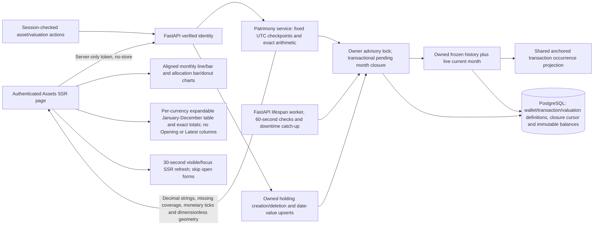

```mermaid
sequenceDiagram
    actor User
    participant Web as Next.js page / server actions
    participant API as FastAPI verified-subject API
    participant Service as Patrimony service
    participant DB as PostgreSQL
    User->>Web: Open Assets with selected year
    Web->>Web: Require session independently
    Web->>API: GET /api/v1/assets?year=N (server-only bearer, no-store)
    API->>Service: Verified owner, year, fixed UTC date
    Service->>DB: Lock owner; seed initial history or close pending completed UTC months
    Service->>DB: Read immutable historical values and current live movements/valuations
    DB-->>Service: Exact numeric values or unknowns
    Service-->>API: Per-currency totals, signed geometry, missing coverage and once-rounded changes
    API-->>Web: Private no-store response
    Web-->>User: Exact monthly table, cards and aligned toggleable charts
    User->>Web: Add holding or save dated total valuation
    Web->>Web: Independently require session and validate input
    Web->>API: POST asset / PUT owned asset valuation
    API->>DB: Transaction: owner lock, pending closure, owned holding insert/upsert
    alt Successful write
        DB-->>API: Commit
        API-->>Web: 201 or 204
        Web->>Web: Revalidate Assets only after success
        Web-->>User: Close dialog and render refreshed snapshot
    else Invalid/foreign/unavailable
        API-->>Web: Explicit 422 / 404 / 503
        Web-->>User: Keep edits and show refusal
    end
    User->>Web: Confirm deletion of holding and all valuations
    Web->>API: Independently authenticated DELETE asset
    API->>DB: Delete WHERE owner = verified sub; cascade only its valuations
    Note over API,DB: Frozen balances survive; historical holding becomes inactive
    API-->>Web: 204 (foreign/missing: 404)
    Web->>Web: Revalidate Assets after success
```

```mermaid
sequenceDiagram
    participant Worker as API lifespan worker (60-second checks)
    participant Write as Financial mutation / Assets read
    participant DB as PostgreSQL
    Worker->>DB: Lock owner; detect completed UTC months
    DB-->>Worker: Last sealed month
    loop Each pending month, oldest first
        Worker->>DB: Previous close + effective owned due movements; latest manual valuation
        Worker->>DB: Insert immutable balance rows; advance closure cursor
    end
    Worker->>DB: Commit; release owner lock
    Write->>DB: Acquire same owner lock
    Write->>DB: Catch up pending closure before editing definitions
    Write->>DB: Commit mutation and catch-up atomically
    Note over Worker,DB: Initial history reconstructed once; no overwrite on later closes
    Note over Worker,DB: Downtime catches up; unavailable DB logs retry and API returns 503
```

### Live development

Start once with `make local-dev-up`. Ordinary source edits do not recreate
containers or modify PostgreSQL data. Dependency/environment changes require
rerunning the target, and new SQL files require `make migrate`.

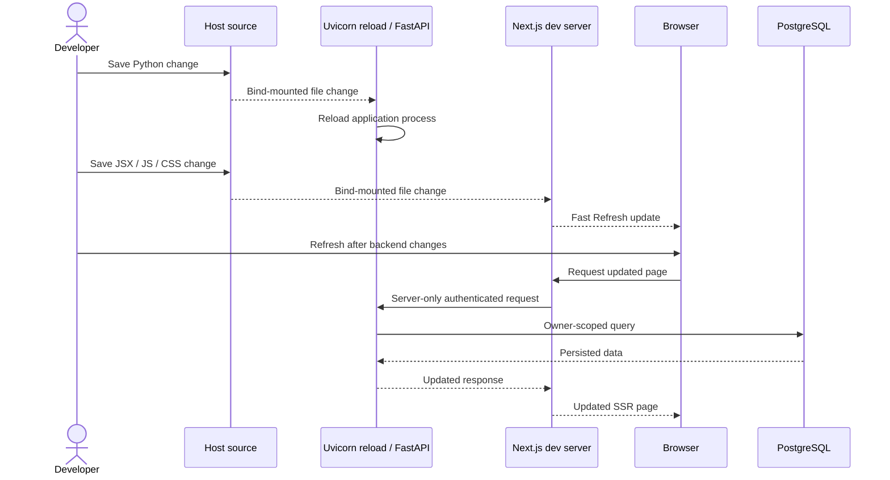

### Sign-in and session

Requires real Auth0 configuration; implemented through the official SDKs.

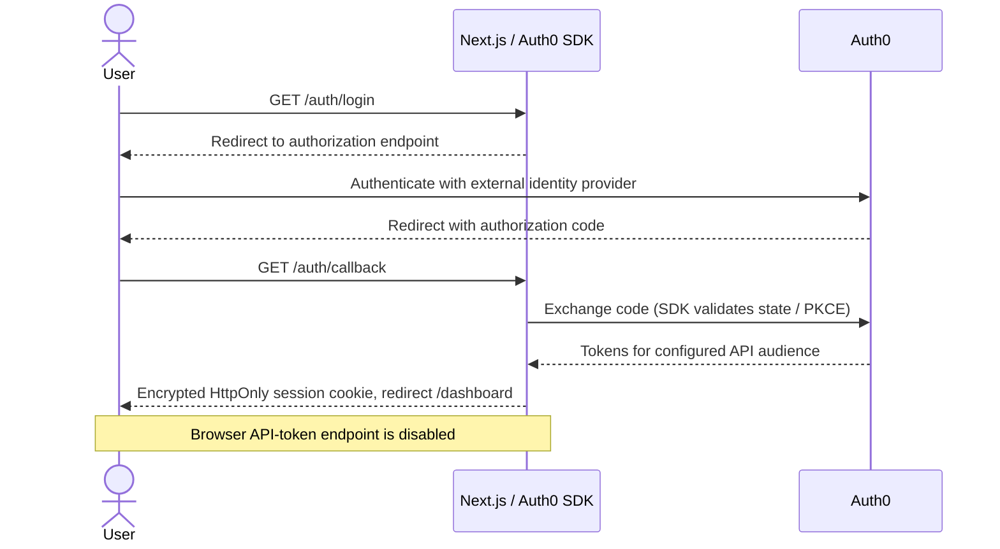

### Token renewal

Requires the [Auth0 refresh settings](../frontend/README.md#automatic-token-renewal).
Tokens remain server-only inside the encrypted HttpOnly session cookie; session
limits and refresh-token expiry/revocation still require sign-in.

```mermaid
sequenceDiagram
    actor User
    participant Proxy as Next.js proxy
    participant SDK as Official Auth0 SDK
    participant IdP as Auth0
    participant SSR as Session-checked page or action
    participant API as FastAPI
    User->>Proxy: Request with encrypted session cookie
    Proxy->>SDK: getSession(request)
    SDK-->>Proxy: Session or null
    opt Session exists
        Proxy->>SDK: getAccessToken(request, response)
        alt Token valid outside 60-second buffer
            SDK-->>Proxy: Existing token
        else Expired/near-expiry token with refresh credential
            SDK->>IdP: Discover issuer and exchange refresh token over HTTPS
            alt Successful renewal
                IdP-->>SDK: Access token and optional rotated refresh token
                SDK->>Proxy: Update request session and response cookie
            else Revoked or rejected grant
                SDK-->>Proxy: Typed login-required failure
                Proxy-->>User: Private no-store redirect to login with pathname returnTo
            else Provider, discovery or configuration outage
                SDK-->>Proxy: Typed unavailable failure
                Proxy-->>User: Private no-store 503, Retry-After 5
            end
        else SDK session expiry or missing refresh token at expiry
            Proxy-->>User: Require login
        end
    end
    opt Request continues without a token-error response
        Proxy->>SSR: Continue with updated request cookies
        SSR->>SSR: Independently require session
        alt No valid session
            SSR-->>User: Redirect to login
        else Valid session
            SSR->>API: Server-only bearer request, no-store
            API-->>SSR: Owned response or explicit error
            SSR-->>User: HTML and encrypted HttpOnly session cookie, no token props
        end
    end
    Note over SDK,SSR: Page/action token calls also handle typed renewal failures; unexpected errors rethrow
    Note over User,IdP: Rotation overlap handles concurrent requests; no browser token endpoint or TLS bypass
```

### Authenticated profile

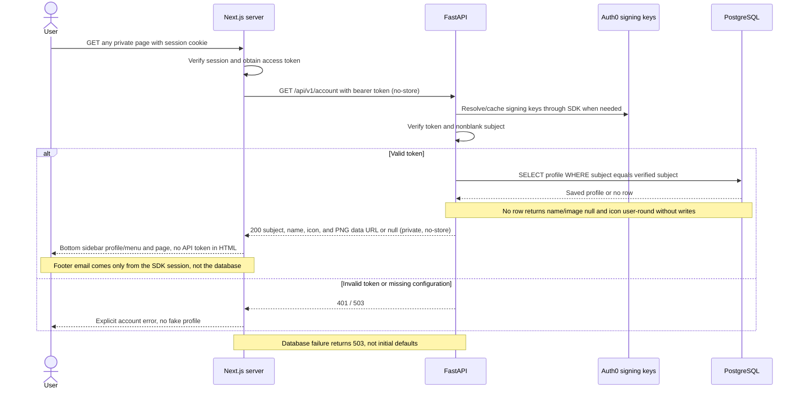

### Account update

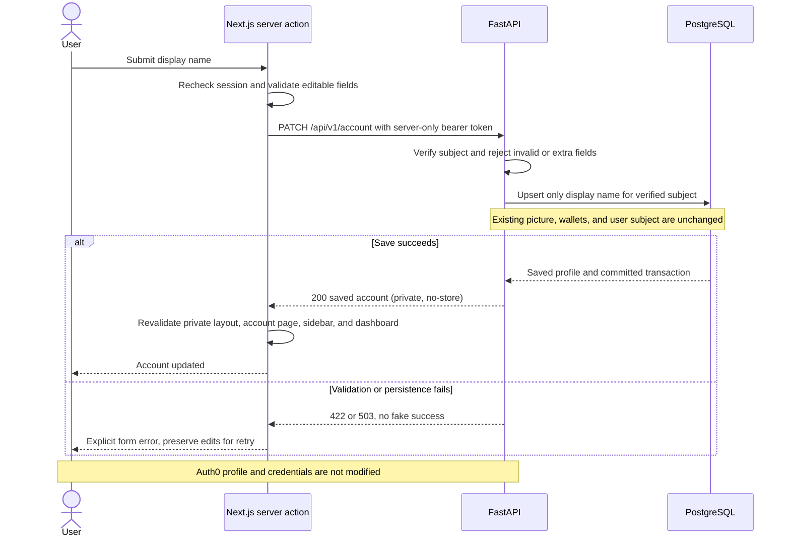

### Workspace settings

```mermaid
sequenceDiagram
    actor User
    participant Browser
    participant Web as Next.js SSR and settings action
    participant API as FastAPI verified-identity settings API
    participant DB as PostgreSQL users
    User->>Browser: Open account menu, then Settings
    Browser->>Web: GET /settings with encrypted session cookie
    Web->>Web: Page independently requires session
    Web->>API: Server-only GET /api/v1/settings with bearer token
    API->>DB: SELECT theme, sidebar_order WHERE subject = verified sub
    DB-->>API: Saved preferences or absent row
    API-->>Web: Private no-store preferences; defaults only for successful absent read
    Web-->>Browser: SSR html theme, ordered navigation and editable form
    Note over Web: React cache deduplicates reads only within this render
    User->>Browser: Choose theme, move features with buttons, Save settings
    Browser->>Web: Settings server action
    Web->>Web: Independently require session and validate complete order
    Web->>API: PUT /api/v1/settings with both preferences
    API->>API: Validate light/dark, all six unique IDs and no extra fields
    API->>DB: Atomic verified-subject upsert of preference columns only
    Note over DB: Preserve display name, image and all financial records
    DB-->>API: Saved settings
    API-->>Web: Private no-store saved settings
    Web->>Web: Revalidate root layout only after successful save
    Web-->>Browser: Saved feedback, updated html theme and desktop/mobile order
    Note over Browser,Web: Refusals preserve edits and active appearance/order
    Note over Browser,Web: Read failures show explicit default-shell warnings and no editable form
```

### Preset typography

```mermaid
sequenceDiagram
    participant CLI as shadcn CLI
    participant Project as Frontend source
    participant Build as Next.js build or development compiler
    participant Fonts as Google Fonts
    participant Web as Wealth frontend
    participant Browser
    CLI->>Project: Apply b2CjxkLGi Mira primitives and Mist/Emerald variables
    Note over Project: Root tokens and shared primitives replace local font, corner and title overrides
    Note over Project: Preserve semantic status colours, readable primary ink and global 44px targets
    Note over Project: Retain shared Card gutters and header dividers; balance month-row vertical inset
    Project->>Build: Root IBM Plex Sans loader with inherited headings and tabular amounts
    Build->>Fonts: Download font CSS and font files
    Fonts-->>Build: IBM Plex Sans assets
    Build-->>Web: Compiled CSS, font variables and self-hosted static files
    Browser->>Web: Request page
    Web-->>Browser: SSR HTML with font variables and saved light/dark class
    Browser->>Web: Request own-origin CSS and font assets
    Web-->>Browser: Self-hosted IBM Plex Sans across pages and body-portaled controls
    Note over Browser,Fonts: No browser request to the font provider
```

### Profile image import and removal

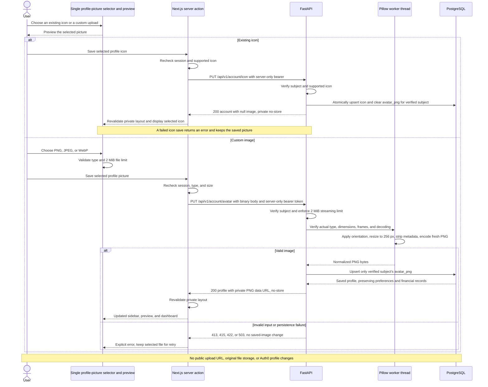

### Wallet creation

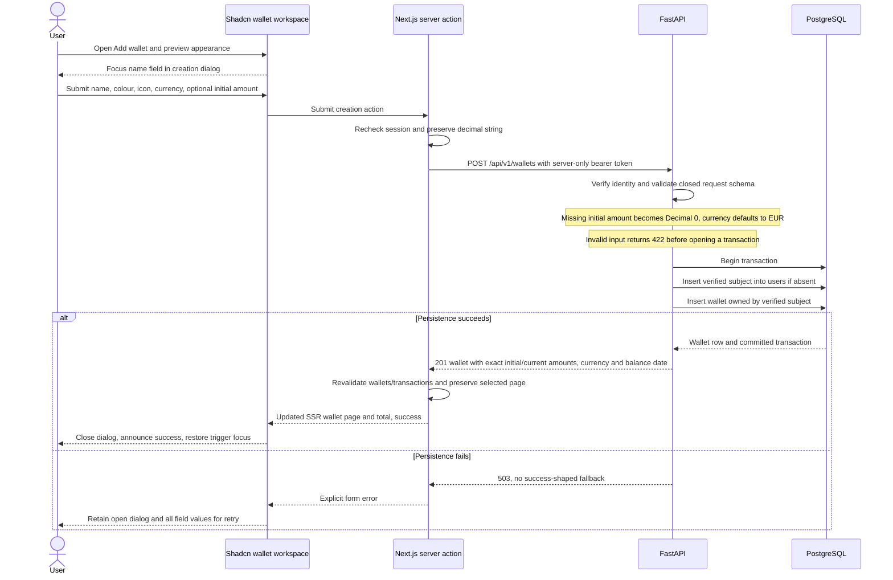

### Wallet listing

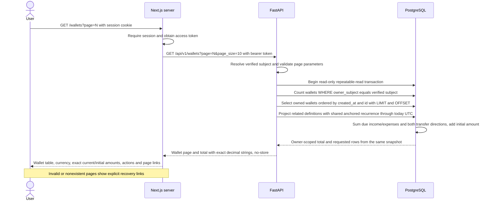

### Wallet balances and management

Current wallet amounts use exact PostgreSQL sums in the same owner-scoped snapshot
as the requested page. Only related definitions are projected, using shared SQL
with transaction history. Due recurring occurrences count, but future entries
(even their first occurrence) do not. Balances are never persisted or rounded.
Migration 009 assigns EUR to existing wallets without changing financial data.
Migration 011 defaults existing wallet types to bank, adds optional normalized
favicon bytes, and extends currency support to BTC/ETH/ITL. Other existing codes
remain readable and editable without conversion. Create/edit pickers show only
EUR/USD/GBP/BTC/ETH/ITL plus the edited wallet's current legacy code if necessary.
Amount sliders are bounded convenience controls paired with exact text entry;
manually entered precision and out-of-range values are not clamped on save.
Icon radio tiles mirror category creation. Custom URL input triggers a debounced
preview through a session-checked action and authenticated API endpoint, without
database access or persistence. It uses the same secure downloader and normalizer
as saving. The UI shows loading/errors, ignores stale responses and restores the
saved preview when the URL is cleared. Only an explicit save persists an image;
blank edit URLs preserve saved bytes, while built-in icons clear them. Wallet
types are descriptive labels, not integrations.

```mermaid
sequenceDiagram
    actor User
    participant UI as Wallet create/edit dialog
    participant SSR as Session-checked Next.js action
    participant API as FastAPI wallet service
    participant Host as Public HTTPS favicon host
    participant Images as Pillow worker
    participant DB as PostgreSQL
    User->>UI: Enter custom favicon URL
    UI->>UI: Debounce 350 ms; ignore stale or closed-form responses
    UI->>SSR: Request preview with URL only
    SSR->>SSR: Independently require session
    SSR->>API: POST /wallets/icon-preview with server-only bearer token
    API->>Host: Secure bounded download with the same rules as saving
    Host-->>API: Image bytes
    API->>Images: Validate and normalize
    Images-->>API: Metadata-free PNG
    API-->>SSR: Private PNG data URL, no database access or persistence
    SSR-->>UI: Update preview or show explicit refusal
    User->>UI: Save type, currency, amount, and custom favicon URL
    UI->>SSR: Submit exact amount string and editable fields
    SSR->>API: POST or PUT with server-only bearer token
    API->>API: Validate URL and all DNS addresses, pin public address
    API->>Host: TLS-verified GET, no redirects or credentials
    Host-->>API: Bounded image bytes
    API->>Images: Verify static ICO/PNG/JPEG/WebP and dimensions
    Images-->>API: Metadata-free PNG, at most 256 pixels per side
    API->>DB: Atomically save owned wallet, type and normalized bytes
    DB-->>API: Commit and exact balance
    API-->>SSR: Wallet with private PNG data URL, no source URL
    SSR->>SSR: Revalidate affected pages after success only
    SSR-->>UI: Stored icon and updated wallet
    Note over API,DB: Rejected download/image leaves wallet unchanged
    Note over UI,Host: Browser renders private data URLs, never contacts the image host
```

```mermaid
sequenceDiagram
    actor User
    participant UI as Shadcn wallet table and dialogs
    participant SSR as Next.js server action
    participant API as FastAPI wallet service
    participant DB as PostgreSQL
    User->>UI: Edit wallet or confirm deletion
    UI->>SSR: Submit UUID and editable fields or deletion
    SSR->>SSR: Independently require session
    SSR->>API: PUT or DELETE with server-only bearer token
    API->>DB: Lock wallet WHERE id and verified owner match
    alt Missing or foreign wallet
        API-->>SSR: Identical 404 Wallet not found
    else Wallet exists
        API->>DB: Check source and destination references including future definitions
        alt Referenced deletion or currency change
            API-->>SSR: 409, rollback without changing history
        else Allowed mutation
            API->>DB: Update editable fields or delete unreferenced wallet
            opt Updated wallet
                DB->>DB: Project due anchored occurrences and compute exact current amount
            end
            DB-->>API: Commit and updated wallet or empty deletion result
            API-->>SSR: 200 wallet or 204
            SSR->>SSR: Revalidate wallets and transactions only after success
            SSR-->>UI: Updated table and success
            UI-->>User: Close dialog, restore focus, recover previous page if needed
        end
    end
    Note over API,DB: Transfer writes/imports share-lock matching wallet currencies
    Note over UI,SSR: Errors keep dialogs and edited fields available for retry
```

### Category management

```mermaid
sequenceDiagram
    actor User
    participant UI as Shadcn category workspace
    participant SSR as Next.js server
    participant API as FastAPI
    participant DB as PostgreSQL
    User->>SSR: GET /categories with session cookie
    SSR->>SSR: Require session and obtain server-only token
    SSR->>API: GET categories and optional preset catalogue
    API->>DB: Read owned categories and subcategories in one snapshot
    DB-->>API: Only the verified subject's two-level tree
    API-->>SSR: Private no-store response
    SSR-->>UI: Owned tree and available presets without API token
    UI-->>User: Separate expense/income sections, each with cards, counts, creation and presets
    opt Search or expand categories
        User->>UI: Search main or child names, or expand a category
        UI->>UI: Filter locally and preserve complete matching trees
        UI-->>User: Expanded matches or a clearable no-match state
    end
    User->>UI: Open an editor or deletion confirmation at either level
    UI-->>User: Appearance preview and icon tiles, or explicit deletion scope
    User->>UI: Submit edit or confirm deletion
    UI->>SSR: Submit selected fields and target IDs
    SSR->>SSR: Recheck session and validate editable fields and target IDs
    SSR->>API: POST, PUT, or DELETE with bearer token
    API->>DB: Mutate only owned rows with the specified main parent
    Note over API,DB: Composite FK rejects foreign owners and subcategory parents; unique indexes reject duplicate names per owner/parent
    alt Valid owned target
        DB-->>API: Commit change, cascading children on parent deletion
        API-->>SSR: 201, 200, or 204
        SSR->>SSR: Revalidate /categories
        SSR-->>UI: Updated tree
        UI-->>User: Close completed dialog, clear search, announce result
    else Invalid input, absent or foreign target, duplicate name, referenced category, or database failure
        API-->>SSR: 422, 404, 409, or 503
        SSR-->>UI: Explicit error
        UI-->>User: Keep dialog open and preserve form edits
    end
```

### Predefined category selection

```mermaid
sequenceDiagram
    actor User
    participant UI as Shadcn preset sheet
    participant SSR as Next.js server action
    participant API as FastAPI
    participant Templates as Read-only preset catalogue
    participant DB as PostgreSQL
    User->>UI: Open Browse presets
    UI-->>User: Available groups, child names, selection count
    User->>UI: Select optional groups and submit
    Note over User,UI: Nothing is added automatically; submit requires a selection
    UI->>SSR: Submit only selected group keys
    SSR->>SSR: Recheck session and require a selection
    SSR->>API: POST /api/v1/categories/import with selected keys
    API->>API: Verify subject and reject unknown keys
    API->>Templates: Resolve only selected predefined groups and children
    Templates-->>API: Names, colours, icons, and subcategory definitions
    API->>DB: Begin transaction and provision user if absent
    loop Selected groups in catalogue order
        API->>DB: Insert private main category unless preset key or name already owned
        alt Newly inserted main category
            API->>DB: Copy listed children under this owned main category
        else Preset key or case-insensitive name already owned
            Note over API,DB: Preserve customized names, styling, and deleted children
        end
    end
    DB-->>API: Commit all selected copies atomically
    API-->>SSR: Count of newly imported groups
    SSR->>SSR: Revalidate /categories
    SSR-->>UI: Updated private tree and remaining optional groups
    UI-->>User: Close sheet and announce import result
    Note over UI,SSR: Validation or backend failures retain the open sheet and selection
```

### Transaction management

```mermaid
sequenceDiagram
    actor User
    participant UI as Shadcn transaction workspace
    participant SSR as Next.js server action
    participant API as FastAPI
    participant DB as PostgreSQL
    User->>UI: Open toolbar creation dialog or entry edit dialog
    UI-->>User: Accessible form with local input state
    User->>UI: Submit optional description, exact amount, date, type, wallets, categories, recurrence
    UI->>SSR: Submit server action
    SSR->>SSR: Independently require session and validate form
    SSR->>API: POST or PUT with server-only bearer token, no-store
    API->>API: Verify subject and closed schema, transfer and recurrence rules
    API->>API: Normalize omitted or blank description to an empty string
    API->>DB: Begin write transaction, lock owned edit target if applicable
    API->>DB: Check and key-share lock owned wallets, main category, and matching child
    API->>DB: Share-lock transfer currencies and reject mismatches
    alt Valid owned references
        API->>DB: Insert or replace definition, composite FKs enforce ownership
        DB-->>API: Commit and return exact decimal definition
        API-->>SSR: 201 or 200, private no-store
        SSR->>SSR: Revalidate transactions and wallet balances only after success
        SSR-->>UI: Updated list and save feedback
        UI-->>User: Close editor and announce saved transaction in its monthly table
        Note over User,UI: Creation closes the dialog, clears filters, and selects the saved month or All dates
    else Invalid input, missing/foreign reference, or persistence failure
        API-->>SSR: 422, 404, or 503 without leaking reference ownership
        SSR-->>UI: Explicit error
        UI-->>User: Keep dialog/form and edits for retry
    end
    User->>UI: Open deletion alert for entry or entire recurring series
    UI-->>User: Explain permanent scope, focus Cancel
    User->>UI: Explicitly confirm deletion
    UI->>SSR: Delete definition by UUID
    SSR->>SSR: Recheck session and definition UUID
    SSR->>API: DELETE owned definition with server-only bearer token
    API->>DB: Delete WHERE id and owner match
    DB-->>API: Commit deletion or missing target
    API-->>SSR: 204 or explicit 404/503
    SSR-->>UI: Revalidate transactions and wallets on success, otherwise explicit error
    UI-->>User: Close on success and restore focus, or retain alert for retry
    Note over User,DB: Recurring edits/deletions affect the entire series, including history
    Note over API,DB: Referenced categories refuse deletion with 409; wallet initial amounts stay unchanged
```

### Transaction bulk changes and pins

```mermaid
sequenceDiagram
    actor User
    participant UI as Transaction table and checked-field editor
    participant SSR as Next.js server action
    participant API as FastAPI
    participant Service as Transaction service
    participant DB as PostgreSQL
    User->>UI: Select unique series on this page or choose row Pin/Unpin
    Note over User,UI: Repeated occurrences share selection; page/filter changes clear it
    UI->>SSR: Selected UUIDs and checked changes, or confirmed deletion
    SSR->>SSR: Independently require session and validate bounded payload
    SSR->>API: Private PATCH/DELETE bulk with server-only token
    API->>API: Verify identity; reject extra fields and duplicate/over-100 IDs
    API->>Service: Apply owned batch
    Service->>DB: Begin transaction; lock owned selected definitions in UUID order
    alt Every definition exists and all merged changes/references are valid
        Service->>Service: Validate each full merged definition; pin-only leaves financial fields untouched
        Service->>DB: Update selected fields/pins or delete entire definitions
        DB-->>Service: Commit all selected changes
        API-->>SSR: Count of changed definitions
        SSR->>SSR: Revalidate transactions, wallets and Summary only after success
        SSR-->>UI: Close dialog, clear successful bulk-edit/delete selection
    else Missing/foreign definition, invalid merged input/reference or persistence failure
        DB-->>Service: Roll back entire batch
        API-->>SSR: Explicit 404/422/503 refusal
        SSR-->>UI: Keep dialog, checked fields, edits and selection
    end
    Note over User,DB: Changes, deletions and pins affect every occurrence of each selected series
    Note over UI,DB: Pins sort matching occurrences first before pagination; totals, filters and balances are unchanged
```

### Signed expenses and category families

Negative expenses reduce spending rather than becoming income. Existing roots
remain expenses; new income templates are optional private copies except where
migration 010 seeds them to reclassify historical income. See
[the migration contract](API.md#category-family-migration).

```mermaid
sequenceDiagram
    actor User
    participant UI as Shadcn category and transaction controls
    participant Action as Session-checked Next.js page or action
    participant API as FastAPI schemas and reference checks
    participant DB as PostgreSQL
    User->>UI: Choose income, expense, or actual transfer
    UI->>UI: Filter owned roots by kind and clear stale root/child choices
    Note over User,UI: Categories shows both family sections; an empty transaction selector links to its family's setup
    opt Import income templates
        User->>Action: Approve selected private preset copies
        Action->>Action: Independently require session
        Action->>API: Import selected income preset keys with server-only token
        API->>DB: Atomically copy owned roots and children without overwriting edits
        DB-->>UI: Successful private copies via API and action
    end
    User->>Action: Save exact signed amount and selected category UUIDs
    Action->>Action: Independently require session and validate input
    Action->>API: Authenticated mutation with decimal strings
    API->>API: Nonzero amount, negative only for expense
    API->>DB: Lock owned root/child and check family and parent
    alt Wrong amount sign or category family
        API-->>UI: Explicit 422 via action; retain form edits, no writes
    else Valid owned references
        API->>DB: Write unchanged exact amount
        DB->>DB: Enforce amount CHECK and generated category-family composite FK
        DB-->>API: Saved definition
        API-->>Action: Private no-store response
        Action-->>UI: Revalidate affected pages after success only
    end
    User->>Action: Subsequent private page read
    Action->>API: Authenticated read with server-only token
    API->>DB: Exact due-only balances and signed expense aggregates
    DB-->>API: Negative expenses reduce spending and increase source balance
    API-->>UI: Exact strings and signed relative geometry via SSR
    UI-->>User: Exact values and diverging plots with visible zero baseline
    Note over User,DB: Income category Transfer is not a wallet transfer; children inherit the root kind
```

### Transaction listing and recurrence

```mermaid
sequenceDiagram
    actor User
    participant UI as Shadcn transaction workspace
    participant SSR as Next.js server
    participant API as FastAPI
    participant Service as Transaction service
    participant DB as PostgreSQL
    User->>UI: Choose year/month, header type switch, filters, or page link
    Note over User,UI: Type switches preserve other filters and reset pagination and selection; badges replace the separate Type column
    Note over User,UI: Month strip centers when it fits; horizontal scrolling keeps every month reachable on narrow screens
    UI->>SSR: GET /transactions with URL month, filters, and page
    SSR->>SSR: Require session and validate URL
    SSR->>SSR: Default to current UTC month, or honor All dates/custom range
    SSR->>SSR: Translate selected month to inclusive date bounds, omit month from API request
    SSR->>API: GET transactions, owned wallet options, and categories with server-only token
    API->>API: Verify subject and filter contracts
    API->>Service: List owned occurrences
    Service->>Service: Fix current UTC as_of date
    Service->>DB: Begin read-only repeatable-read snapshot
    DB->>DB: Select owned definitions and project due dates anchored to original start
    Note over Service,DB: Include future initial entries, not future repetitions; no writes or scheduler
    DB->>DB: Apply literal description, type, either-wallet, category, and inclusive date filters
    DB->>DB: Materialize filtered projection; count and sum by currency, main category and expense wallet
    Note over Service,DB: Net is income minus expenses; transfers count once and never enter net
    DB->>DB: Order is_pinned descending, occurrence date descending with stable ties, select LIMIT/OFFSET page
    DB-->>Service: Owner-scoped page, count, whole-filter currency totals and wallet expenses
    Service->>Service: Generate signed category and cashflow geometry using exact ratios, without money conversion
    Service-->>API: Exact amounts and totals, wallet currencies, dates/numbers, and as_of
    API-->>SSR: Private no-store response, wallet/category names
    SSR-->>UI: Owned result and filter props without API tokens
    UI->>UI: Group pinned entries first, then occurrence months without changing server order
    UI->>UI: Render labelled income/expense/transfer badges with green/red/blue theme pairs
    UI->>UI: Add currency symbols without rounding; omit redundant monthly table headings
    UI->>UI: Render themed red expense gradients with matching swatches; paint tooltips above donut center text
    UI-->>User: Income/expense donuts with exact center totals, labelled net bars, type switches, tables and page links
    Note over User,UI: Currencies stay separate; negative category totals show explained neutral rings and exact signed data; no transfer summary card
    opt Expand wallet expenses, closed by default
        User->>UI: Toggle Expenses by wallet
        UI-->>User: Already fetched exact source-wallet expense totals
    end
    Note over User,UI: Tables scroll horizontally with sticky actions; pagination remains global across months
    Note over User,UI: Year/month changes preserve filters and reset page one; currencies never combine
    Note over User,SSR: Invalid/nonexistent pages show errors; newly due repeats appear on refresh
```

### Annual expense analysis

```mermaid
sequenceDiagram
    actor User
    participant UI as Shadcn annual tables and monthly bar charts
    participant SSR as Next.js Summary page
    participant API as FastAPI summary endpoint
    participant Service as Annual expense service
    participant DB as PostgreSQL
    User->>SSR: Open Summary or select year in URL
    SSR->>SSR: Independently require session and validate year
    SSR->>API: GET /api/v1/summary/analysis?year=N with server-only token
    API->>API: Verify subject and closed year query
    API->>Service: Analyse owned expenses and income for selected year
    Service->>Service: Fix today's UTC cutoff
    Service->>DB: One read-only owned expense/income occurrence and grouping-sets query
    DB->>DB: Project repeats anchored to original date, filter year and due cutoff
    Note over Service,DB: Exclude transfers, future initial entries and future repeats
    DB->>DB: Exact monthly/yearly family/category/currency sums and monthly income minus expenses
    DB-->>Service: Aggregate rows, not raw transactions
    Service->>Service: Assemble hierarchy without monetary arithmetic
    Service->>Service: Rank category totals and normalize geometry with exact fractions
    Service->>Service: Exact chart totals and displayed-ranking sum; category average rounded once to 18 places
    Service-->>API: Expense and income summaries, rankings, grouped monthly and signed net points
    API-->>SSR: Private no-store exact decimal-string response
    SSR-->>UI: Validated aggregate props without token or owner fields
    UI-->>User: One monthly view: grouped income/expenses or diverging net bars
    User->>UI: Switch monthly view or category bar/donut view
    UI->>UI: Presentation only; prohibit donuts for negative totals or all-zero geometry
    UI-->>User: January-December data, exact Totals and ranking Sum/Average
    UI-->>User: Expense tables followed by income tables, with monthly/year totals and category details
    User->>UI: Collapse details or hide category totals
    UI->>UI: Change presentation only, retain grand totals without double-counting
    Note over User,UI: Direct-category expenses use Without subcategory; currencies never combine
    Note over SSR,DB: No provisioning, aggregate persistence, migration or scheduler
```

### Expense charts and period comparisons

```mermaid
sequenceDiagram
    actor User
    participant UI as Shadcn charts and comparison controls
    participant Page as Next.js Compare spending page
    participant Action as Next.js read-only comparison action
    participant API as FastAPI summary service
    participant DB as PostgreSQL
    User->>UI: Switch monthly or category chart with title-right icon toggles
    UI-->>User: Update aligned equal-height plot locally, preserving exact data
    Note over User,UI: Monthly currency ticks are server-generated; tooltip indicators match series/slice colors
    User->>Page: Open Compare spending from its dedicated sidebar link
    Page->>Page: Independently require session and derive current UTC date
    Page-->>UI: Initial period selectors, no annual analysis fetch
    User->>UI: Select 2-6 months, years, or inclusive yearly-average ranges
    User->>UI: Compare periods
    UI->>Action: Closed same-kind selections, no owner or monetary inputs
    Action->>Action: Independently require session and validate input
    Action->>API: POST /api/v1/summary/compare with server-only token
    API->>API: Verify subject, distinct started periods, nonfuture range endpoints and fixed UTC cutoff
    API->>DB: One owned read-only occurrence/grouping-sets statement
    DB->>DB: Exact due expense sums, excluding income, transfers and future entries
    opt Yearly averages
        DB->>DB: Divide range expenses by inclusive calendar years, including zero-spend years
        DB->>DB: Round exact quotient/remainder once to 18 places
        Note over UI,DB: Included current year is partial, counts as one year, and is not annualized
    end
    alt Successful database read
        DB-->>API: Period/category/currency aggregates only
        API->>API: Align absent cells and compute shared relative coordinates with exact fractions
        API-->>Action: Private no-store response, decimal strings and dimensionless integers
        Action-->>UI: Validated period metadata and currency-separated results
        UI-->>User: Grouped bars, numbered legend, year/month counts and full exact tables
    else Database unavailable
        DB-->>API: Unavailable
        API-->>Action: 503
        Action-->>UI: Explicit error
        UI-->>User: Preserve edits and labelled last-successful comparison
    end
    Note over User,UI: Category/comparison axes are relative; monthly axes use currency labels; exact amounts never become JavaScript numbers
    Note over Action,DB: No mutation, revalidation, provisioning, migration or stored aggregates
```

### CSV transaction import

```mermaid
sequenceDiagram
    actor User
    participant UI as CSV import dialog
    participant SSR as Session-checked Next.js actions
    participant API as FastAPI and CSV service
    participant DB as PostgreSQL
    participant Presets as Read-only predefined catalogue
    User->>UI: Select UTF-8 CSV and delimiter
    UI->>SSR: Upload bounded file
    SSR->>SSR: Require session and obtain server-only token
    SSR->>API: Authenticated raw text/csv
    API->>API: Bound, parse, infer unambiguous header mappings
    API-->>UI: Headers, included rows, initial mapping via SSR
    Note over UI,DB: No upload file, financial rows or receipt persisted
    User->>UI: Map columns, choose fallbacks, date order or decimal separator
    UI->>SSR: Validate mapped rows
    SSR->>API: Authenticated JSON
    API->>DB: Read owned wallets and two-level categories in snapshot
    API->>Presets: Check main-category names and preset-key aliases
    Presets-->>API: Canonical names, appearance and preset provenance
    Note over API,DB: Exact owned names/UUIDs win; renamed owned preset copies are reused
    API->>API: Normalize recognized currency-marked decimals and supported dates
    API->>API: Validate same-currency transfers, report destination-wallet row alerts
    API->>API: Accept unmapped or blank description as an empty string
    API->>API: Propose deduplicated missing named references from included rows
    API-->>UI: Creation recap, normalized fields and row errors via SSR
    opt Missing records require approval before transaction review
        User->>UI: Approve names, parents, icons/colours and zero EUR wallet amounts
        UI->>SSR: Validate with approved creation UUIDs
        SSR->>API: Require session, authenticated rows and approval
        API-->>UI: Read-only approved report via SSR
    end
    Note over UI,DB: Recap approval creates no users, references or transactions
    User->>UI: Correct or exclude rows and revalidate
    alt Discard before confirmation
        User->>UI: Discard or close
        UI->>UI: Unmount upload and clear preview state
    else Explicitly confirm selected valid rows
        UI->>SSR: Confirm with per-upload UUID retry key
        SSR->>API: Require session, authenticated mapped rows and retry key
        API->>DB: Begin transaction, serialize owner reference creation, lock key and check receipt
        alt Identical committed key
            DB-->>API: Original imported count, no new inserts
        else New key
            API->>DB: Lock current owned references
            API->>API: Revalidate selected rows and current creation approval
            alt Invalid row, no selection, or unapproved changed plan
                API->>DB: Roll back
                API-->>UI: 422 and fresh row alerts via SSR
            else Valid selected rows
                API->>DB: Provision minimal user if needed, insert approved missing references
                API->>DB: Insert selected definitions and hash/count receipt
                API->>DB: Commit atomically
            end
        end
        API-->>SSR: Confirmed count or explicit failure
        SSR->>SSR: Revalidate transactions, wallets and categories only on success
        SSR-->>UI: Count; open All dates, or preserve review for retry
    end
    Note over UI,DB: Retry interrupted confirmation unchanged; no duplicate inserts
```

### Database migration

```mermaid
sequenceDiagram
    participant Compose
    participant Runner as Migration runner
    participant DB as PostgreSQL
    Compose->>DB: Wait for healthy database
    Compose->>Runner: python -m app.db.migrate
    Runner->>DB: Begin transaction and acquire advisory lock
    Runner->>DB: Ensure schema_migrations and read applied versions
    loop Pending SQL files in filename order
        Runner->>DB: Execute migration and record version
    end
    alt All migrations succeed
        Runner->>DB: Commit and release lock
        Runner-->>Compose: Exit 0
        Compose->>Compose: Start API
    else A migration fails
        Runner->>DB: Roll back and release lock
        Runner-->>Compose: Exit nonzero, API stays stopped
    end
```

### Database readiness

```mermaid
sequenceDiagram
    participant Probe
    participant API as FastAPI
    participant DB as PostgreSQL
    Probe->>API: GET /ready
    API->>DB: Connect with 3-second connect timeout and run SELECT 1
    alt Query succeeds
        DB-->>API: Result
        API-->>Probe: 200 ready
    else Missing configuration or database failure
        API->>API: Log configuration/error type without credentials
        API-->>Probe: 503 Database is unavailable
    end
    Note over Probe,API: GET /health checks only process liveness
```

### Unconfigured setup

```mermaid
sequenceDiagram
    actor User
    participant SSR as Next.js
    User->>SSR: GET /
    SSR->>SSR: Check required Auth0 environment names
    SSR-->>User: Setup message listing missing names, not values
    User->>SSR: GET /dashboard, /wallets, /categories, /account, or /auth/login
    SSR-->>User: Redirect /, no session or mock identity issued
```
