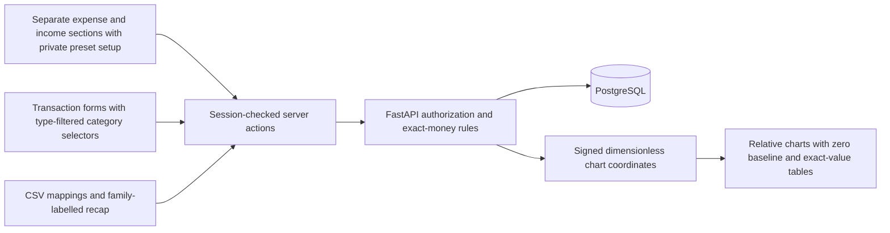

# Wealth frontend

Next.js App Router SSR in JavaScript/JSX with Tailwind CSS and registry-generated
shadcn/ui components. Python remains the API, business-rule, and persistence
authority. Read [AGENTS.md](AGENTS.md) and the bundled Next.js guides before
changing framework APIs.

## Auth0 setup

Create an Auth0 **API** with a stable identifier and **RS256** signing. Set its
tenant hostname (without scheme/path) as `AUTH0_DOMAIN` and its exact identifier
as `AUTH0_AUDIENCE` in both root `.env` and `frontend/.env.local`.

Create a separate **Regular Web Application** for this frontend. Give it
user-delegated access to that API and configure refresh tokens as below.
Do not use a machine-to-machine application
for end-user login.

Register these local values:

| Setting               | Value                                 |
| --------------------- | ------------------------------------- |
| Allowed Callback URLs | `http://localhost:3000/auth/callback` |
| Allowed Logout URLs   | `http://localhost:3000`               |
| Allowed Web Origins   | `http://localhost:3000`               |

```bash
cp frontend/.env.example frontend/.env.local
openssl rand -hex 32
```

Set the generated value as `AUTH0_SECRET`, then set the application's
`AUTH0_CLIENT_ID` and `AUTH0_CLIENT_SECRET`. Set `APP_BASE_URL` to the registered
browser-facing origin. Do not commit populated environment files.

### Callback URL mismatch

This error comes from Auth0 before it returns control to Wealth. In the Auth0
Dashboard, select the configured tenant, open **Applications > Applications**,
and select the Regular Web Application whose Client ID matches
`AUTH0_CLIENT_ID` in `frontend/.env.local`.

Under **Settings**, add `http://localhost:3000/auth/callback` to **Allowed
Callback URLs**, preserving any existing entries, and click **Save Changes**.
Also register the logout URL and web origin listed above. Retry login from
`http://localhost:3000/auth/login`, not the previous Auth0 error page.
Changing only the Auth0 allowlist does not require restarting containers.

The callback must match the SDK's `redirect_uri`, including scheme, hostname,
port, and path. `/dashboard` is the destination after the callback completes,
not the callback itself. `localhost` and `127.0.0.1` are different hosts.
Compose sets `APP_BASE_URL=http://localhost:3000`; use that browser origin for
local deployment. For another deployment origin, update both `APP_BASE_URL`
and the Auth0 allowlists, then recreate the frontend container. Do not use
wildcard callbacks or disable callback validation.

`BACKEND_API_URL` is the origin reached by the **Next.js server**, not by the
browser. Native mode uses `http://localhost:8000`; Compose overrides it with
`http://backend:8000`. Local HTTP is allowed only with
`APP_ENV=development`. Other origins require HTTPS. No `/api` path suffix,
embedded credentials, query, or fragment is accepted.

The SDK handles `/auth/login`, `/auth/callback`, and `/auth/logout` through
`proxy.js`. Rolling token refresh happens before rendering so session cookies
can be updated. Pages still enforce the session; proxy redirects are not the
authorization boundary. The browser-facing access-token endpoint is disabled.

### Automatic token renewal

Configure these settings in the Auth0 Dashboard:

1. **Applications > APIs > Wealth API > Settings > Access Settings**: enable
   **Allow Offline Access**. Its Identifier must still match `AUTH0_AUDIENCE`.
2. **Applications > Applications > Wealth Regular Web Application > Settings >
   Advanced Settings > Grant Types**: enable **Refresh Token**. Keep the
   application OIDC-conformant and preserve its authorization-code grant.
3. In the application's **Settings > Refresh Token Rotation**, enable
   **Allow Refresh Token Rotation**. Set a small **Rotation Overlap Period**,
   for example **3 seconds**, to accommodate concurrent page/prefetch requests.
   Choose absolute and inactivity expiry limits appropriate to your session
   policy; rotation does not extend an absolute refresh-token lifetime.
4. Save changes, then **sign out and sign in again**. An existing session without
   a refresh token cannot acquire one merely by enabling these settings.

Wealth already requests `openid profile email offline_access`; no new environment
variables or browser SDK are required. Dashboard-only changes need no container
restart. If you change frontend environment values, run `make local-dev-up`.
See Auth0's [API settings](https://auth0.com/docs/get-started/apis/api-settings)
and [rotation guide](https://auth0.com/docs/secure/tokens/refresh-tokens/configure-refresh-token-rotation).

Before rendering, the official Next.js SDK refreshes expired access tokens and
tokens within a **60-second expiry buffer**, when a refresh token is available.
It propagates the updated session to SSR and persists the access token and any
rotated refresh token inside the encrypted HttpOnly session cookie. Page/action
API calls also handle typed SDK renewal failures. Tokens never appear in page
props, browser storage, or a browser-facing token endpoint.

Missing/expired sessions, absent refresh tokens at expiry, and revoked/rejected
grants require login. Temporary provider/discovery/configuration failures return
an explicit private/no-store **503**, not a login loop or empty financial data;
proxy responses include `Retry-After: 5`. Refresh the page to retry. Session and
refresh-token absolute/inactivity limits still apply. The test suite verifies SDK
refresh and rotation against a synthetic provider, not your actual tenant.

The public home page shows setup instructions when settings are absent.
After sign-in, `/dashboard` is the landing dashboard. It calls
`/api/v1/account` server-side and displays the saved display name, image (or
fallback icon), and verified identity or an explicit backend error, never a demo
profile, plus links to manage the account and wallets.

## Interface and page structure

The application uses shadcn preset **`b2CjxkLGi`**: **Radix Mira**, **Mist**
base colours, **Emerald** theme/charts, **Lucide** icons, default radius, and
**IBM Plex Sans** typography with inherited headings. The preset was applied
with `shadcn apply b2CjxkLGi --yes`; configuration lives in `components.json`,
tokens in `app/globals.css`, and generated primitives in `components/ui/`.
This is one global design, not a per-page preset. Cards and custom panels use
the shared large radius, controls retain Mira's medium radius, and dialogs use
the registry's dialog radius and title typography. Call sites control layout
and semantic variants, not alternate fonts, button shapes, or dialog-title sizes.
Financial values inherit the same font with tabular numerals; their exact
decimal strings and server-generated chart geometry remain unchanged.
Category cards retain the shared Card padding/gap and the header's built-in
divider spacing, rather than suppressing vertical gutters. The scrollable
month row has equal top/bottom inset so the selected button and focus ring
clear the rail edges without changing month centering or horizontal scrolling.

IBM Plex Sans is loaded once through `next/font/google` in the root layout: Next.js fetches
it during the build (or development compilation), then serves the font files
from Wealth's own static assets. Browsers never contact Google for fonts.
Building the frontend therefore requires access to the font provider in addition
to normal package/image downloads.

Global accessibility rules preserve 44-pixel buttons/icon targets, inputs and
menu items, including slotted dialog/sheet controls, without duplicating size
overrides across pages. Registry focus rings and overlays apply throughout;
reduced-motion handling and existing income/expense/transfer colours remain.
The `primary-ink` token uses preset primary in light mode and its brighter
sidebar primary in dark mode, keeping branded text/icons readable without
changing the preset's button/background colours. Shared link buttons also use
this readable ink. Preserve these global adaptations when regenerating
primitives. Charts use shadcn Chart/Recharts; no sample
financial values or invented balances are introduced.

The welcome page explains the implemented features and offers provider sign-in
only when configured. The dashboard is an action-oriented starting point with
profile access and links to wallets, categories, and transactions, not an
analytics or balance summary. Unexpected rendering failures offer retry/home
actions; expected API failures remain explicit within their page.

`/dashboard`, `/wallets`, `/transactions`, `/summary`, `/compare-spending`, `/categories`, `/account`, and `/settings` share the `(app)`
route-group layout and sidebar.
Navigation highlights the current page and stays visible across private pages.
Desktop uses a sticky left rail; phones use a compact sticky header with all six
navigation destinations visible and the account menu beside the wordmark.
Narrow phones arrange navigation in two rows of three; wider mobile screens use
one row of six.
A bottom desktop profile footer shows the
saved image/icon, name, and session email when available. Its keyboard-accessible
three-dot menu opens **Manage account**, **Settings**, and **Sign out**. Profile image controls
remain on the account page; account management is not a main navigation item.
The footer uses "Wealth account" if no session email exists, not an invented email. Profile
read failures show an explicit error while leaving management/sign-out available.
A skip-to-content link remains available. Each page independently checks the
session; the shared layout is not an authorization boundary.

### Workspace settings

Open **Settings** from the account menu to choose **Light** or **Dark** and move
sidebar features up/down with labelled, keyboard-accessible buttons. All six
features remain available; the account menu stays fixed. Changes apply only
after **Save settings**, to both desktop and mobile navigation. Failed saves
keep the edited theme/order and show an explicit error without changing the
active appearance or sidebar. Preferences belong to the verified user and are
saved through [the settings API](../docs/API.md#workspace-settings), not browser storage.

The root layout reads authenticated settings server-side and places the theme
on `<html>` before the initial document is sent, including body-portaled menus
and dialogs. Public/unconfigured sessions need no settings API call. Native
controls use the matching CSS `color-scheme`. React `cache` deduplicates reads
only within a server render; HTTP requests remain private/no-store and never
share another user's preferences. Each private page/action independently checks
the session. Successful settings saves revalidate the root layout because
appearance affects the whole application.

Settings read failures are explicit, not disguised as saved defaults: the shell
announces its default appearance/navigation, and the settings page withholds the
form until a successful read. Refresh retries the request. No new dependency,
provider credential, token endpoint or browser-side database access is introduced.

`/wallets` lists only the signed-in user's wallets, ten per page, with
Previous/Next links, current page, and total count. Page selection lives in
`?page=N`, so reloads, direct links, and browser history preserve it. Pagination
is performed by the owner-scoped API/database query, not by fetching all wallets
into the browser. Invalid page parameters and nonexistent pages show explicit
errors with recovery links rather than pretending the user has no wallets.

The wallet list is a semantic shadcn table with Wallet, Currency, Initial amount,
Current amount, and Actions columns. Exact decimal strings are right-aligned;
the Wallet cell also shows its bank/trading/exchange type. Create/edit dialogs
use a keyboard-operable initial-amount slider from -100,000 to 100,000 in 0.01
steps, paired with an exact decimal text field. Manual values outside that range
or with additional precision are preserved without JavaScript monetary math;
only moving the slider replaces the exact field with its chosen value.
The currency picker offers Euro, Dollar, Sterling, Bitcoin, Ethereum, and Italian
lira, retaining an existing legacy currency only for that wallet. Icon selection
uses the same labelled radio-tile pattern as category creation, not a dropdown.
**Custom favicon** accepts a direct public HTTPS ICO/PNG/JPEG/WebP URL. After a
350 ms pause in URL input, the preview updates automatically through a
session-checked, non-persisting API download with the same validation as saving.
Loading and refusal feedback is explicit; stale responses and closed-dialog
results are ignored. Saving independently downloads, validates, normalizes, and
stores the image. Existing images are shown in the preview/table; clearing a
replacement URL restores the saved preview, leaving the edit URL blank preserves the image,
and selecting a built-in icon removes it. No browser remote image request is
made. See [the wallet API contract](../docs/API.md#custom-wallet-favicons) for limits
and refusal behavior. Wallet types are labels, not bank/exchange integrations.

In the table,
horizontal keyboard scrolling and sticky 44px edit/delete actions remain usable
on phones. Current amounts are computed server-side from initial amounts and
income/expenses/transfers due through the displayed UTC date, including recurring
occurrences. Future entries do not affect current amounts.

**Add wallet** opens a focused creation dialog with an appearance preview, name,
colour, icon, currency (default Euro/EUR), and initial amount (default `0`). Errors retain all fields and keep
the dialog open for retry. A successful save closes it, announces the result, and
restores focus to Add wallet; canceling does not create a wallet.
Its server action independently rechecks the
session, posts with a server-only token, and revalidates `/wallets` and `/transactions` only after a
successful save. The selected page stays unchanged; wallets are ordered oldest
first, so a new wallet may appear on a later page. Persistence/validation
failures are shown explicitly.

Row **Edit wallet** opens the same form with existing values and preserves edits
on failure. Changing the starting amount recalculates the balance.
Currency cannot change while any transaction references the wallet.
Row **Delete wallet** opens a confirmation alert with Cancel focused by default.
Referenced source/destination wallets refuse deletion without removing history.
Successful deletion of the final row on a later page returns to the preceding
page; removed triggers return focus to the wallets heading.
Each action independently requires a session and revalidates affected pages only
after success. Transaction saves/deletions also revalidate wallet balances.
Transaction forms display the selected wallet currency; transfers require
matching currencies and never perform conversion.

`/transactions` uses a compact month-based workspace with a shared page heading,
scrollable month/year navigation, an illustrated empty state, and a toolbar
**Add transaction** button that never overlays record actions. Registry-generated shadcn Popover, Sheet, Dialog,
ScrollArea, and Empty components provide the search, filters, creation dialog,
month rail, and empty state; colors follow the existing application theme.
History uses registry-generated shadcn tables with selection, Wallet (stored
icon/colour or private favicon), Description and categories, Date, Type, Amount,
and Actions columns. Categories and recurrence sit beneath the description;
transfer destinations sit beneath the source wallet. Dates show Today/Yesterday
against the API's UTC date, otherwise short dates with the year when needed.
No time is invented for date-only records. Rows are grouped by their occurrence
month on the current page, including separate month sections under All dates,
with pinned occurrences in a leading Pinned section.
Type badges use semantic light/dark color pairs: green income, red expense, and
blue transfer. Visible labels and distinct icons retain meaning without color;
all three foreground/background pairs meet normal-text contrast requirements.
Year selection is separate from a January-December rail. Year arrows preserve
the selected month; the year button opens a focused numeric picker for years
1 through 9999. Month arrows still cross year boundaries. The selected year is
shown once, and month buttons show abbreviated names with full accessible labels.
Monthly tables do not repeat the selected month/year heading; All dates retains
month headings to distinguish its separate groups.
Default ordering
is pinned first, then occurrence date descending, using the API's stable server-side order
before pagination rather than sorting one page in the browser.
Each table has semantic headers and an announced descending Date column.
Keyboard-focusable horizontal scrolling keeps wide tables within the viewport;
sticky row actions remain reachable on small screens. Amounts remain exact,
right-aligned strings with the source wallet's currency symbol beside the
unrounded amount and a currency-code text alternative. Income/refunds display
`+`, ordinary expenses `-`, and transfers remain neutral. These signs do not
change exact stored values or use JavaScript monetary arithmetic.
Long descriptions/reference names wrap instead of being truncated. The sticky
three-dot row menu offers Edit, Pin/Unpin, and Delete. Editing opens the existing focused dialog.
Descriptions are optional in creation, editing, and CSV imports. Blank or omitted
descriptions remain empty strings; history and action labels display
"Untitled transaction" without saving that placeholder. The 500-character limit
still applies, and existing descriptions are preserved unless edited/cleared.
Deletion uses a shadcn alert dialog, defaults focus to Cancel, and keeps API
refusals open for retry; deleting the focused entry returns focus to the history
heading. Active filters are visible as wrapping text badges with a clear action.
Ten-occurrence pagination remains global across month sections; a month can
continue on another page. Recurring rows remain projected occurrences, with
whole-series edit/delete scope unchanged.

Row and header checkboxes select unique series on the current page; repeated
occurrences of one series stay synchronized. Header/toolbar select-all controls
share checked/indeterminate state. Changing page or filters clears selection.
The selection toolbar offers bulk editing, pin/unpin, confirmed deletion and
clear selection. Bulk editing changes only explicitly checked fields; changing
a main category clears the old subcategory unless a replacement is checked.
Unchecked fields are disabled and stay unchanged, even for mixed transaction types.
Every merged record must accept the changes or the API rolls back the whole
batch. Failed saves/deletions keep the dialog, edits and selection for retry.
Cancel restores the initiating control; successful removal of that control
restores the history heading. All operations independently require a session.
Bulk operations affect whole selected series, including other pages/filters.
Pins persist server-side and sort matching occurrences before pagination, without
changing filters, occurrence projection, totals or balances.
See [the bulk API contract](../docs/API.md#bulk-updates-deletion-and-pins).

A Summary precedes the list with Expenses, Income, Transfers, and Net income
(income minus expenses; transfers excluded). It covers all matching occurrences
across pagination and respects every active filter, using API-provided exact
totals rather than browser arithmetic. Multiple currencies are shown separately,
never converted or combined. **Expenses by wallet** uses the existing shadcn
Collapsible, closed by default, with exact source-wallet expense totals only.
Opening it persists across pagination; changing filters/period resets it closed.
Empty matches show zero totals and an explicit empty wallet breakdown.
Summary scope matches history, including any matching first future entry, and
does not represent current wallet balances.

The initial period is the current UTC month. `?month=YYYY-MM` selects a month;
**Transaction options > All dates** removes the monthly boundary. Search,
type, either wallet, categories, and page remain in the URL. Changing months
preserves these filters and resets page one; year changes do the same. The filter sheet exposes custom
date bounds under **All dates / custom range**. Existing links with explicit
date bounds and no month remain custom-range views; combining an explicit month
with custom dates is rejected rather than silently ignoring a filter.
Monthly views translate to the API's existing inclusive date bounds server-side;
the frontend-only `month` parameter is never sent to the API.
The month strip is centered within its navigation bar when all twelve months
fit, and remains horizontally scrollable without clipping either end on smaller
screens. The month rail recenters its selection when available width changes, without
scrolling the document vertically. Filter/search overlays reset their local state
after URL changes without remounting the creation dialog or losing save feedback.

**Import CSV** opens a shadcn dialog: upload, map columns/formats, approve any
missing-record recap, and review transactions.
Known headers are matched automatically; users can associate other columns with
transaction fields, supply fallback values, correct individual rows, and exclude
rows (all start included). The preview shows 20 records per page, field-specific
alerts, selected/error counts, normalized amounts/dates alongside original CSV
values, and a disabled confirmation until the selected
rows are valid and changes have been revalidated. Error links open the affected
row editor and focus its override control. Discarding/closing before confirmation
unmounts the upload/preview without saving anything, including approved missing
wallets/categories/subcategories. Recap cards show record names, parent categories,
icons/colours, and zero initial amounts/EUR currency for new wallets. Editing rows, mappings,
or formats invalidates approval and requires revalidation.

Main-category CSV values also match predefined names and keys. Exact owned
names/UUIDs win; a renamed owned preset copy is reused by its preset key.
Otherwise the recap labels the matched group and shows its predefined
appearance. Only referenced records are created after final approval, never
all of the group's unreferenced children.

Amount validation recognizes supported currency symbols/codes and dot/comma
decimals without rounding or currency conversion. Date validation detects
supported calendar formats from valid unambiguous included records. The mapping
screen's decimal-separator and date-order controls resolve ambiguity explicitly;
unknown currency markers and invalid dates remain linked row alerts.

Import actions independently require a session, forward files/JSON server-side,
and obtain no browser tokens. FastAPI parses bounded UTF-8 CSVs and resolves only
owned UUIDs or unique wallet/category names and proposes missing plain names.
Recap approval is another read-only validation, not an early creation request.
Only included rows contribute proposed records. FastAPI atomically revalidates
and inserts approved references plus selected rows on final confirmation.
Successful imports revalidate wallets, categories, transactions, and Summary.
After success, All dates displays imported
history and a count; normal transaction CRUD and entire-series recurrence rules
still apply. An interrupted confirmation locks editing/discard until an unchanged
retry retrieves the result using the same key, avoiding accidental duplicates.
No browser storage, server temporary upload files, or runtime dependencies are
added. Limits and exact mapping/validation rules belong in the
[API reference](../docs/API.md#reviewed-csv-transaction-imports).

The creation dialog defaults to today for the current month/all dates, or the
first day of another selected month. Failed saves retain the open dialog and
edits. Successful creation closes it, clears filters, and opens page one of the
saved entry's month (or stays in All dates). Create a wallet and main category
first; missing prerequisites show management links inside the dialog. Wallet
choices include all owned wallets, not only the first wallet page.
Invalid filters or nonexistent pages still show explicit recovery links.

Amounts remain exact strings: expenses may be positive or negative (refunds),
but never zero; income and transfers remain strictly positive.
Expense amount fields use a sign-capable text keyboard on phones; income and
transfer fields retain decimal keyboard hints. Validation still preserves exact
decimal strings.
Income uses income categories; expenses and transfers use expense categories.
Changing the transaction type clears category and subcategory selections.
Missing income categories link directly to income category/preset setup.
Income labels the source-wallet field
as the receiving wallet. Transfer destinations appear only for transfers and
must differ from the source. Subcategory choices follow the main category;
changing a parent clears the selected child.

Repeat weekly, monthly, or annually, indefinitely (blank count) or for 1 to 10000
total occurrences including the first. The list includes repeats due through
the API's UTC date and future initial entries, not future repetitions. Calendar
repeats stay anchored to the original day, clamping shorter months. Editing or
deleting a recurring entry affects the entire series, including history, and
is clearly labeled/confirmed; per-occurrence exceptions are not implemented.
All transaction pages/actions independently check the session. Failed saves
preserve edits; only successful saves/deletions revalidate `/transactions`,
`/wallets`, and `/summary`.
Transactions do not change the displayed wallet initial amounts.

### Annual expense analysis

The private **Summary** navigation entry opens `/summary`, defaulting to the
current UTC year. Previous/next year arrows and a focused numeric year picker
support years 1 through 9999, with URL-based history and explicit invalid-year
feedback. The page independently requires a session and fetches
`GET /api/v1/summary/analysis?year=N` with a server-only token, no caching or redirects.

**Spending at a glance** uses registry-generated shadcn Chart containers and
Recharts: a **Bar Chart - Multiple** shows monthly expenses and income side by
side, or a **Bar Chart - Negative** shows monthly net income (income minus
expenses). Positive net bars mean surplus, negative bars mean deficit, with a
visible zero baseline. **Monthly chart view** shows only one monthly chart at a
time, defaulting to income and expenses, with the choice applied across currencies.
Both chart sections use compact cards and 240–260-pixel plots, arranged side by
side on wide screens and stacked on smaller screens. Matching native select
controls switch chart types. **Category chart view** defaults to **Bar chart**:
horizontal bars rank the top ten expense categories; **Donut chart** switches
to their relative shares with named exact-value legend entries. Donuts are
disabled when displayed totals are negative or all plot coordinates are zero;
refunds are never converted into positive slices. **Bar chart** restores ranking.
All chart tables include January through December, including the current year:
months after today's UTC cutoff are zero due activity, not forecasts.
Expense/income bars share one scale; the net chart has
its own scale. Every chart has
exact-data disclosure tables and exact tooltips. Monthly data tables include
a **Totals** row for expenses, income, and net income. Ranking data includes
**Sum** and **Average** of the displayed categories, not a monthly average or an
all-category sum. All aggregates come from the backend; averages round once
half-up to 18 places and sums stay exact. Animations are disabled, chart
colors adapt to dark mode, and accessible names describe each currency/plot.
Axes explicitly show a relative scale, not currency: only server-generated
dimensionless coordinates become chart numbers. Monetary strings remain intact.
When values are negative, charts use a diverging signed scale with a visible
zero baseline, normalized by the largest absolute magnitude; positive-only
charts retain their existing scale. Rankings remain descending net expenses,
not absolute spending. Refunds reduce expense totals and increase net income
and wallet balances; exact signed values remain available in tables/tooltips.

### Spending comparisons

The dedicated **Compare spending** sidebar entry opens `/compare-spending`,
separate from annual Summary charts and tables. Its page independently requires
a session and initializes selectors from the current UTC date without fetching
annual analysis or comparison results.
**Compare spending** selects 2–6 months, years, or yearly averages.
Add/remove periods, then explicitly submit **Compare periods**. The independently
session-checked action invokes the read-only comparison API; API tokens never
reach the client. A successful result shows grouped horizontal bars for up to
eight categories, a numbered period legend, and an exact table for every category
plus currency totals. Series follow the legend's order rather than relying only
on color. All compared categories share a scale within their own currency.
The keyboard-scrollable table remains available without hover.
Failed requests preserve the edited selectors and clearly labelled last-successful
results; reopening the comparison page starts a new workspace independent of
the Summary year.
Yearly averages have **From year / To year** controls. Each range includes both
endpoints: sum its due expenses and divide by its number of calendar years,
including zero-spend years. A range may end this year but not in a future year;
the current year is partial and is not annualized. Legends expose the year
denominator and partial-year status. They round once to 18 places;
ordinary sums never round. See [the exact contract](../docs/API.md#charts-and-period-comparisons).

Migration `014_comparison_navigation.sql` adds the comparison feature after
Summary in saved sidebar orders, preserving other feature ordering, theme, and
profile preferences. Apply it with `make migrate`.

### Annual analysis tables

Expense tables are followed by income tables. Each family has one shadcn table
per currency, showing categories/subcategories down the first
column, January–December across the next twelve, and a highlighted Year total.
The currency's annual total appears above the table, and Total expenses / Total income supplies
monthly/yearly grand totals without double-counting category subtotals.
Subcategories start expanded; individual keyboard-operable category buttons and
Expand/Collapse all support a compact category-only overview.
**Show category totals** hides the subtotal amounts without removing their group
labels, subcategory amounts, or grand totals. Display choices reset for a new year.
Entries directly assigned to a main category appear as **Without subcategory**.

The named/focusable scroll region keeps the category column and month headers
visible while scrolling horizontally/vertically. The mobile navigation retains
six accessible targets, with truncated long labels on the narrowest widths.
Exact amounts and currency symbols are displayed without browser arithmetic,
rounding, or mixing currencies. Only each family's entries due through today's UTC
date are included; transfers and future initial entries are excluded. Income-only
currencies still show monthly charts and income tables. An empty family/year and a
backend failure have distinct UI states; failures never show fake zero totals.
Successful transaction/import actions and category rename/delete actions
revalidate Summary. Charts add the registry Chart component and Recharts runtime
dependency; no database schema is added.
Expense totals, income totals and net amounts share one backend occurrence snapshot.
See [the contract](../docs/API.md#annual-expense-analysis) and
[sequence](../docs/IMPLEMENTATION_STATUS.md#annual-expense-analysis).

`/account` manages the user's Wealth display name and profile picture in one
Profile card with clearly separated personal-details and picture sections.
The read-only verified identifier lives in an expandable security section rather
than dominating the profile or dashboard. Name saves use `PATCH /api/v1/account` without modifying the
picture. The **Profile picture** selector offers the existing icons or
**Custom image (upload)**, sharing one live preview and **Save profile picture**
button. Saving an icon uses `PUT /api/v1/account/icon` to replace any custom
image atomically; uploading uses the authenticated binary image endpoint.
Unsaved profiles start with an empty display-name field and the Person icon.
All actions independently recheck the session and revalidate the private layout,
sidebar, account page, and dashboard only after success. Failed saves preserve
edits and the previously saved picture. The authenticated subject is read-only.
Auth0 still manages email, passwords, and provider settings.

The custom-image option accepts PNG, JPEG, or WebP up to 2 MiB and 4096 pixels
per side, with a local preview and explicit save feedback. SVG/GIF and animated
images are unsupported. Browser validation rejects unsupported/oversized files;
the server action independently rechecks sessions and file limits before sending
a raw binary body with a server-only token. The API validates actual content,
applies orientation, resizes to at most 256 pixels per side, and strips metadata.
Only normalized private PNG bytes are stored in PostgreSQL. Profile responses
embed a PNG data URL; no browser bearer endpoint, external avatar URL, or public
upload is introduced.

The Next.js Server Action body limit is 3 MiB to accommodate the 2 MiB file limit
plus multipart overhead; the application and API still reject files above 2 MiB.
Failed saves keep the selected file and saved image unchanged. Successful
picture changes refresh the shared footer and dashboard. Select and save an
existing icon to switch back from a custom image; there is no separate image
removal control or second avatar preview. Name saves leave the active picture
unchanged. See [the image contract](../docs/API.md#custom-profile-images).

`/categories` shows separate **Expense categories** and **Income categories**
sections together in a responsive card workspace. Each section has its own
main/subcategory counts, creation button, and family-specific preset catalogue,
with optional expansion of each tree.
Shared search matches parent and child names across both sections without case or accent sensitivity;
matching trees expand with all their children so the parent relationship stays
clear. Search does not send extra API requests. Distinct empty and no-match
states explain how to start or clear the search.

Creation and editing use focused shadcn dialogs with a live appearance preview,
labelled colour control, and keyboard-operable icon radio tiles. Subcategories
inherit the parent's initial appearance but remain independently editable.
Successful mutations close the dialog, clear search so saved records remain
visible, and announce the result. Failed saves retain the dialog and its edits.
Neither family is hidden behind a selector. The transaction form shows only
categories matching its selected type, explains that scope beside the selector,
and links an empty family to its section for explicit setup
(`?kind=income#income-categories` opens income setup). Main-category creation can
select either family; editing preserves its immutable family. Children inherit
their root's family. Main-category names must be unique within the account and
family, and child names within
their parent, regardless of casing or surrounding whitespace. A duplicate save
shows a unique-name error, not the referenced-category deletion warning.
Subcategories cannot have children.

Item menus offer editing and explicit deletion confirmation in an alert dialog.
Deleting a main category also deletes its subcategories; canceling leaves records
unchanged. Categories/subcategories used by transactions refuse deletion with an
explicit error that keeps the confirmation open; reassign/delete their
transactions first. Keyboard focus returns to the initiating control, or to the
family's create button when the deleted control no longer exists.

**Browse presets** opens an optional shadcn sheet showing available groups and
their included subcategory names for that section's family. The optional income
catalogue contains Salary, MealTicket, Transfer, Cash, and Other; Other has exactly
`refund` and `private sell`. The income category Transfer is not a wallet-transfer
transaction. Existing expense presets are unchanged. Entire group tiles are selectable; a selected
count and submission button remain visible while the catalogue scrolls. Adding
is disabled until a group is selected. Users explicitly choose which groups to
copy into their account; nothing is added automatically. Imported copies can be
renamed, restyled, or extended with
custom subcategories, independently of other users. Already imported groups and
groups whose names match an owned custom category in the same family are hidden from the selector;
duplicate imports do not overwrite edits.
Deleting an imported group makes it available again unless another owned
category has the same name. All category server actions independently recheck
sessions and revalidate `/categories` and `/transactions` only on success;
form edits survive a failed save. The workspace retains JavaScript/JSX, Tailwind,
and registry-generated shadcn primitives without a new form library or runtime
dependency. See the [API contracts](../docs/API.md#categories) and
[category operation diagram](../docs/IMPLEMENTATION_STATUS.md#category-management).

CSV reference matching and creation proposals use the transaction's family.
The recap explicitly labels main-category families; same-named income and expense
groups remain separate, and wrong-family UUIDs remain row errors.

```mermaid
sequenceDiagram
    actor User
    participant UI as Next.js forms / CSV recap
    participant Action as Session-checked server action
    participant API as FastAPI
    participant DB as PostgreSQL
    User->>UI: View separate expense and income sections; optionally copy presets
    User->>UI: Choose type and signed exact amount
    UI->>UI: Show owned categories of the selected type; clear stale selections
    UI->>Action: Submit exact decimal strings / approved CSV
    Action->>API: Private authenticated mutation
    API->>DB: Validate family and nonzero expense / positive income-transfer
    DB-->>API: Save owned references and transactions atomically
    API-->>Action: Confirm success
    Action-->>UI: Revalidate affected pages
```



Keep amounts as strings from `FormData` through JSON to display; never convert
them with `Number`, `parseFloat`, or a currency formatter that coerces to binary
floating point. A blank form amount is omitted so the API/database zero default
applies. Icon choices must stay consistent with the API schema and migration.

## UI and validation

Shared shadcn button recipes provide at least 44-pixel-high controls, including
dialog close buttons. Inputs/selects use consistent heights, and native selects
fill their available column. Semantic surface/text tokens support both existing
theme variants; no theme-switching feature is introduced. Dialogs/sheets fit the
viewport and scroll internally, and reduced-motion preferences disable component
animations/transitions. Sticky navigation has scroll clearance and a
keyboard-operable skip link. Names and exact decimal strings wrap instead of
overflowing small layouts.

The mock-backed browser suite exercises all six pages at 320, 375, 768, and 1440
pixels, captures phone/desktop and dark-surface views, and covers focused mutation
dialogs, retained errors, keyboard focus, and existing financial workflows.

For live Docker development, run `make local-dev-up` from the repository root
and leave the services running. `next dev` provides Fast Refresh for
bind-mounted frontend source, while Uvicorn reloads backend Python changes.
The browser remains at `http://localhost:3000`; refresh it to fetch updated
server-rendered data after API changes. Dependencies and build output stay
inside containers. See the [runbook](../docs/RUNBOOK.md#live-development) for
dependency/environment changes, migrations, and switching to production mode.

Run Docker commands from the repository root:

```bash
make frontend-test
make frontend-lint
make frontend-build
make frontend-test-browser
```

For native development, use Node.js 22.13+ or 24+:

```bash
make frontend-install
npm --prefix frontend run dev
npm --prefix frontend run test:single -- --test-name-pattern=refusal tests/api-client.test.js
npm --prefix frontend run format
```

`components.json` selects JavaScript (`tsx: false`), React Server Components,
the Radix Nova registry style, and `@/` aliases. Add registry components using
the installed shadcn CLI rather than recreating lookalikes:

```bash
cd frontend
npx shadcn add <component>
```

Do not expose API tokens through client props, `NEXT_PUBLIC_*`, local storage,
or a browser token endpoint. Server-only SDK/API wrappers import `server-only`;
the pure configuration and HTTP helpers remain independently testable.

See the [runbook](../docs/RUNBOOK.md) for the complete check matrix and the
[operation diagrams](../docs/IMPLEMENTATION_STATUS.md#operation-sequence-diagrams)
for session/profile boundaries.
